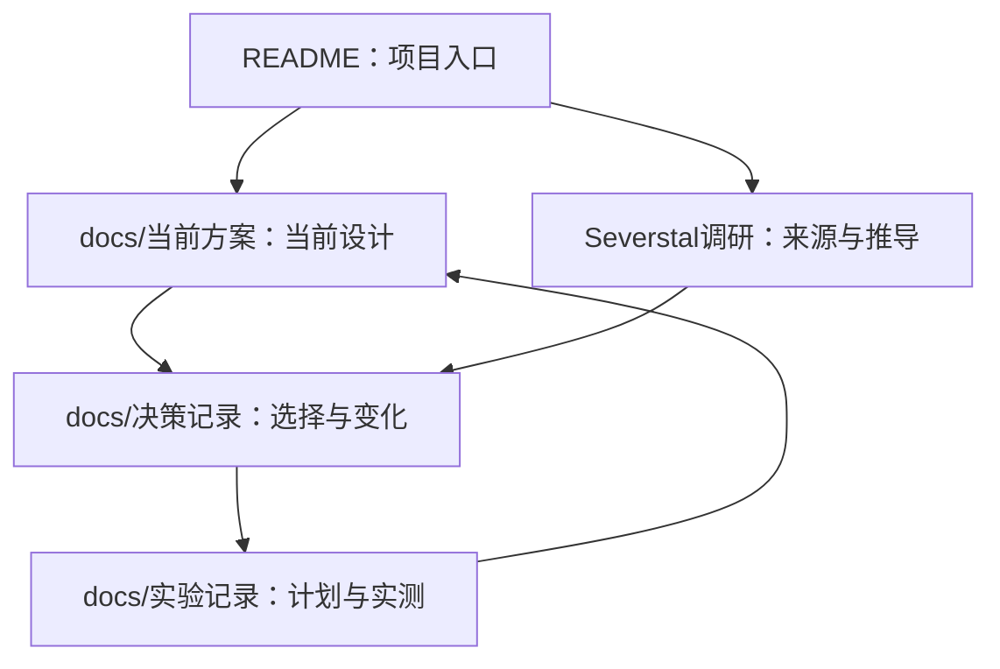

# BigData 项目索引

更新：2026-10-22。项目：Severstal 钢板表面四类缺陷分割，服务课程展示、报告和答辩。

## 入口

- 人类阅读入口：[README](README.md)。
- 协作维护规范：[AGENTS.md](AGENTS.md)，规则统一维护于此。
- 作业原始要求：[作业要求](作业要求.md)。
- 当前阶段与方案：[当前方案](docs/当前方案.md)。

## 文档结构

## 模块索引

| 模块 | 用途 | 本地索引 |
| --- | --- | --- |
| `docs/` | 当前方案、决策与实验 | [docs/CLAUDE.md](docs/CLAUDE.md) |
| `Severstal调研/` | 赛题事实、公开方案观察与设计依据 | [调研/CLAUDE.md](Severstal调研/CLAUDE.md) |

现阶段为调研与方案设计，尚无本项目源码、数据、权重或训练结果；运行入口在实现后补充。

`.spec-workflow/` 为通用模板，不属于项目模块。后续新增模块时更新本索引，具体配置与实验结果仍写入对应文档。
