# 展示图册

2026-10-24 从已保存数据与实验记录重绘；没有新增训练或推理。PNG 用于插图，SVG 用于缩放；原图像素、真值和概率均来自已有材料。

A：U-Net＋ResNet34；B：FPN＋SE-ResNeXt50；C：U-Net＋EfficientNet-B3。`raw/` 指仓库下的 `runs/defense_materials_20261024/raw/`，源码与配置路径以仓库为根。

## 从数据出发：类别不平衡、正常图与多类共存

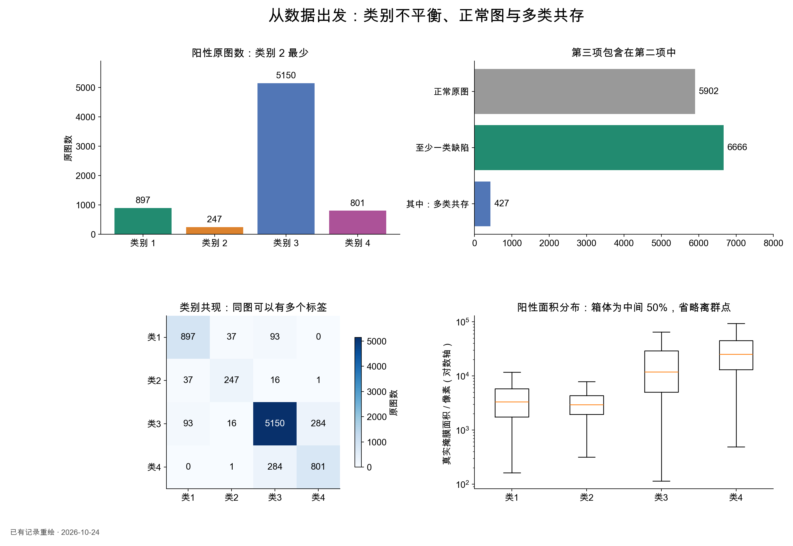

- 观察：12,568 张原图中，5,902 张正常；类别 2 仅 247 张阳性。四类数量不能相加当作原图总数。
- 口径：统计对象为有标签的全部训练数据；测试集没有真值，不参与此图。
- 来源：`raw/data/severstal/train.csv`、`raw/data/split_seed42.json`
- 文件：[PNG](01_dataset.png) · [SVG](01_dataset.svg)

## 原始图像与标注：四类、正常图、多类图

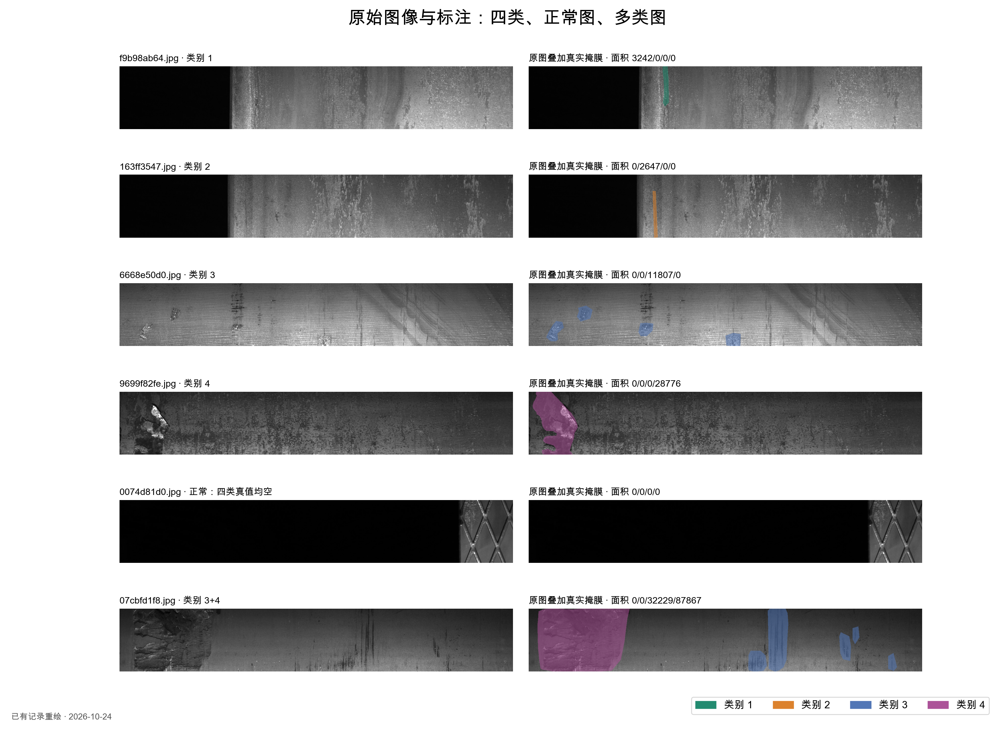

- 观察：缺陷有不同尺度和外观；正常图也可能有黑区和规则纹理。彩色区域是真实标签，不是模型预测。
- 口径：四类各取验证集面积排序中间样本，正常与多类各取文件名排序首图；不能代表所有形态。
- 来源：`raw/data/severstal/train_images/`、`raw/data/severstal/train.csv`、`docs/答辩材料索引.md`
- 文件：[PNG](02_examples.png) · [SVG](02_examples.svg)

## 局部放大：把细窄缺陷看清楚

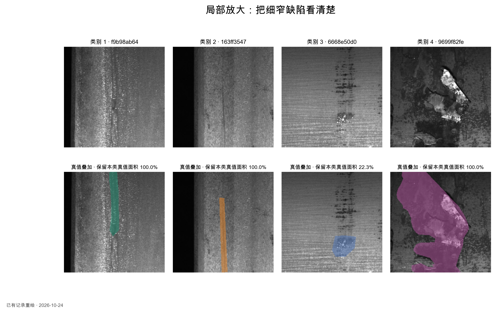

- 观察：同一批四类原图的局部视图，颜色仅表示真实标签。细窄标签在全图缩小时容易看不清。
- 口径：横向以距本类掩膜重心最近的真值像素为中心，截取256×256窗口；保留全部高度。图下注明窗口内本类面积占比；不是模型预测。
- 来源：`raw/data/severstal/train_images/`、`raw/data/severstal/train.csv`
- 文件：[PNG](02b_example_details.png) · [SVG](02b_example_details.svg)

## 数据如何进入训练、融合和官方测试

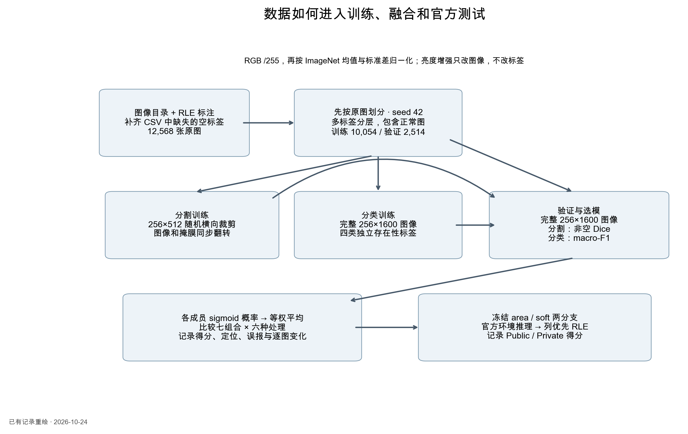

- 观察：先划分原图再裁剪，避免同一图像的不同裁块跨训练与验证；分类器使用全图。
- 口径：按现有代码与配置绘制的流程示意，不是新增实验。
- 来源：`severstal/data.py`、`configs/`、`docs/决策记录.md#d33`、`docs/决策记录.md#d49`
- 文件：[PNG](03_data_flow.png) · [SVG](03_data_flow.svg)

## 同一张阳性原图，裁剪后可能没有缺陷

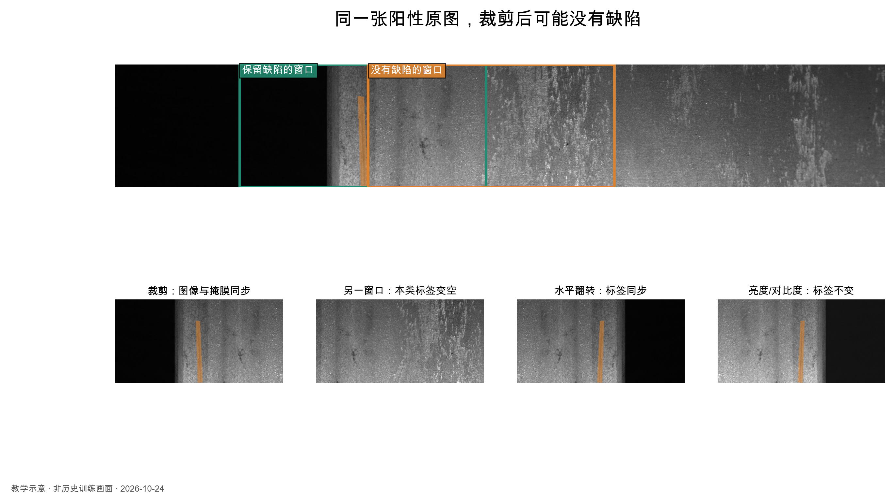

- 观察：裁剪会改变实际看到的标签；几何变换必须同时应用到图像和掩膜。
- 口径：本次用验证样本重画的教学示意，窗口按有无缺陷选择；不是历史训练批次，也未将该样本用于训练。
- 来源：`severstal/data.py:SteelDataset.__getitem__`、`raw/data/severstal/train_images/163ff3547.jpg`
- 文件：[PNG](04_paired_crop.png) · [SVG](04_paired_crop.svg)

## RLE 怎样恢复像素标签

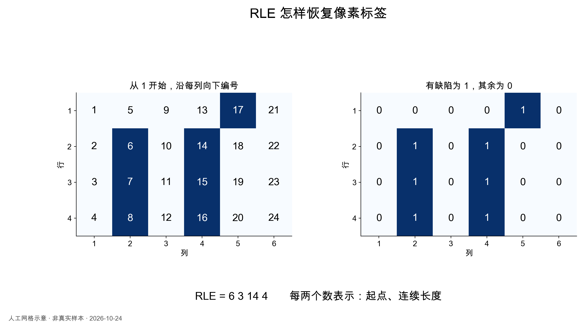

- 观察：先减去 1 得到数组起点，再按列恢复二维掩膜；展开顺序错误会使位置错乱。
- 口径：4×6 人工小网格，用于解释编码；并非真实钢板样本。
- 来源：`severstal/data.py:decode_rle`
- 文件：[PNG](05_rle.png) · [SVG](05_rle.svg)

## 完整训练曲线：学习进展与选模时点

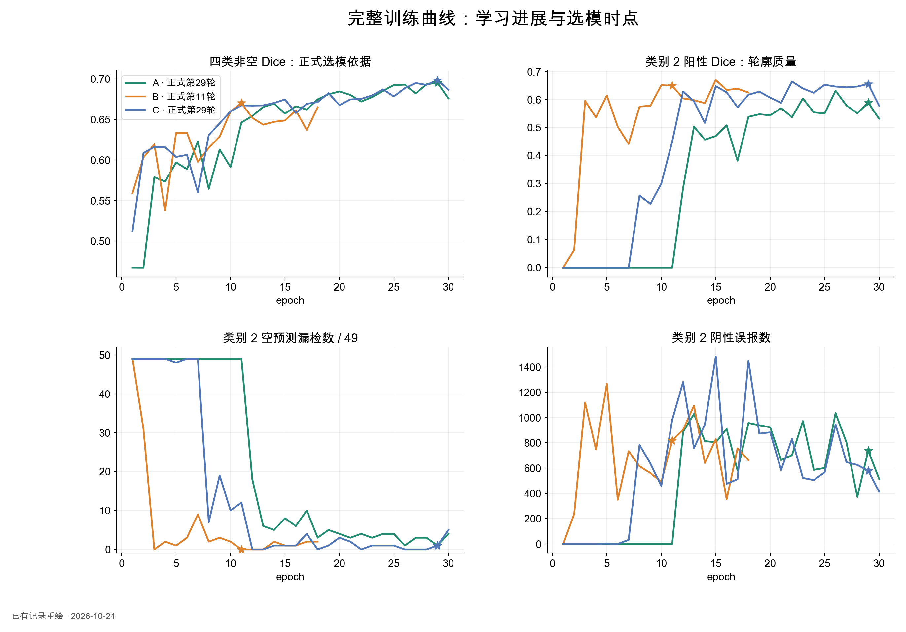

- 观察：A/B/C 分别训练 30/18/30 轮，正式选中 29/11/29。类别 2 的学习在早期明显滞后。
- 口径：原始验证输出，尚未施加共同面积过滤；空预测漏检不包括预测非空但位置错误的样本。星号是选中权重。
- 来源：`raw/runs/E02-r01/history.jsonl`、`raw/runs/E02-r03/history.jsonl`、`raw/runs/E02-r04/history.jsonl`
- 文件：[PNG](06_training.png) · [SVG](06_training.svg)

## 分类器的选择：综合表现与类别 2 召回

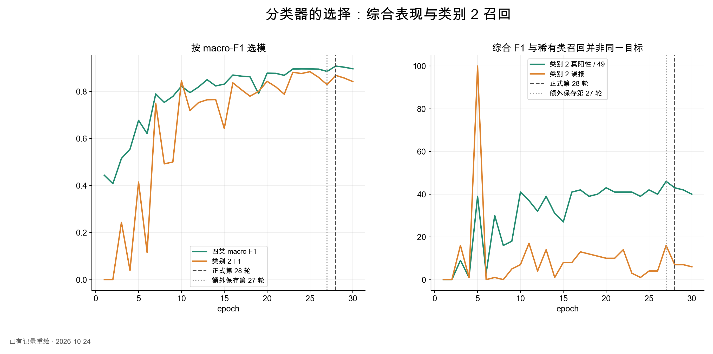

- 观察：正式使用第 28 轮；第 27 轮因类别 2 召回较高被额外保留，但没有用于主门控对照。
- 口径：展示已有训练记录；不能把分类正确率直接当作分割定位质量。
- 来源：`raw/runs/E02-r02/history.jsonl`、`docs/决策记录.md#d43`
- 文件：[PNG](07_classifier.png) · [SVG](07_classifier.svg)

## 类别 2：198 张阳性原图，对应约 67.2 次阳性裁剪期望

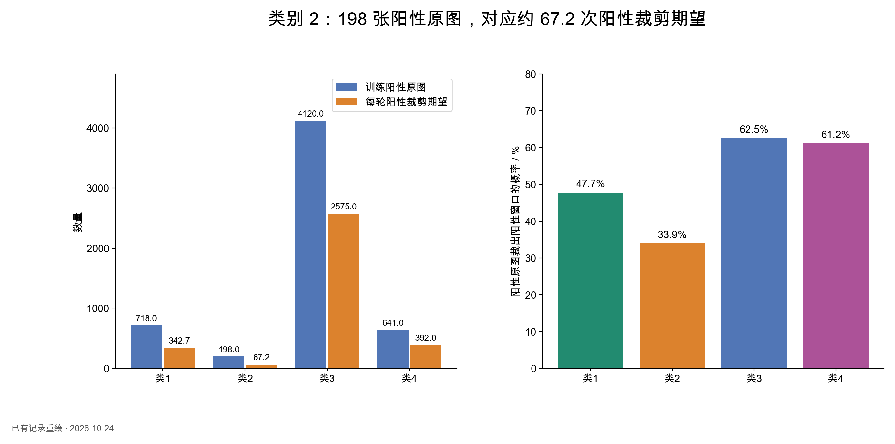

- 观察：每图每轮随机取一个 512 像素窗口时，类别 2 阳性原图保留阳性的平均概率约 33.9%。
- 口径：对全部 1,089 个合法横向位置统计的期望，非实际采样日志；尚未做采样策略的因果对照。
- 来源：`docs/results/E06-r01/crop_exposure.json`
- 文件：[PNG](08_crop_exposure.png) · [SVG](08_crop_exposure.svg)

## 七组合 × 六种处理：总分、轮廓、误报与定位同时看

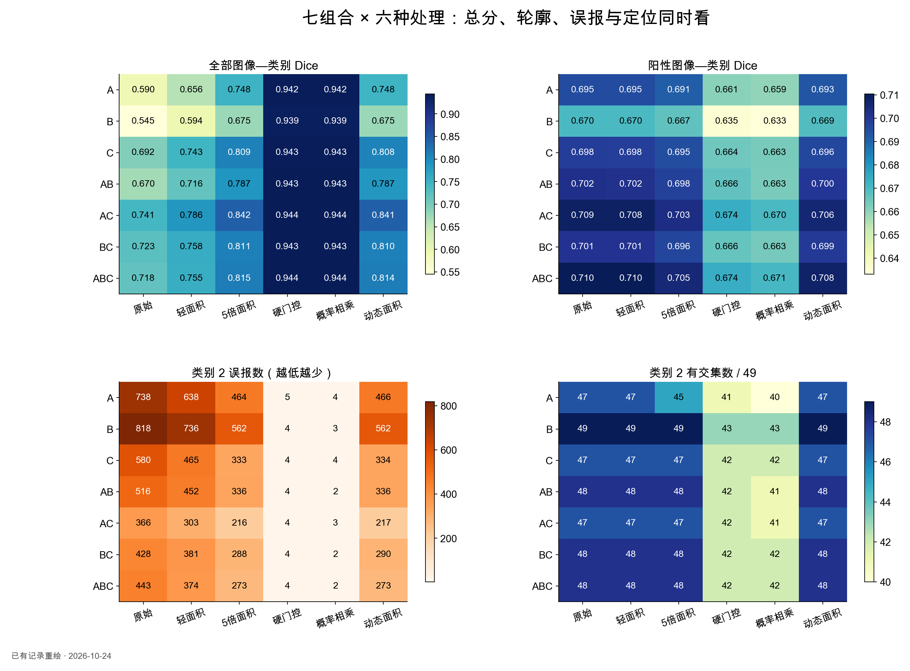

- 观察：soft 的总体 Dice 高，但阳性 Dice 与类别 2 定位降低；最优组合随评价目标而变化。
- 口径：统一开发验证集、统一阈值；六处理定义见 E04/D41。颜色标尺在每个子图内独立。
- 来源：`docs/results/E03-r02/summary.json`
- 文件：[PNG](09_ensemble_heatmaps.png) · [SVG](09_ensemble_heatmaps.svg)

## 类别 2 全部 49 张阳性：每张图的融合变化

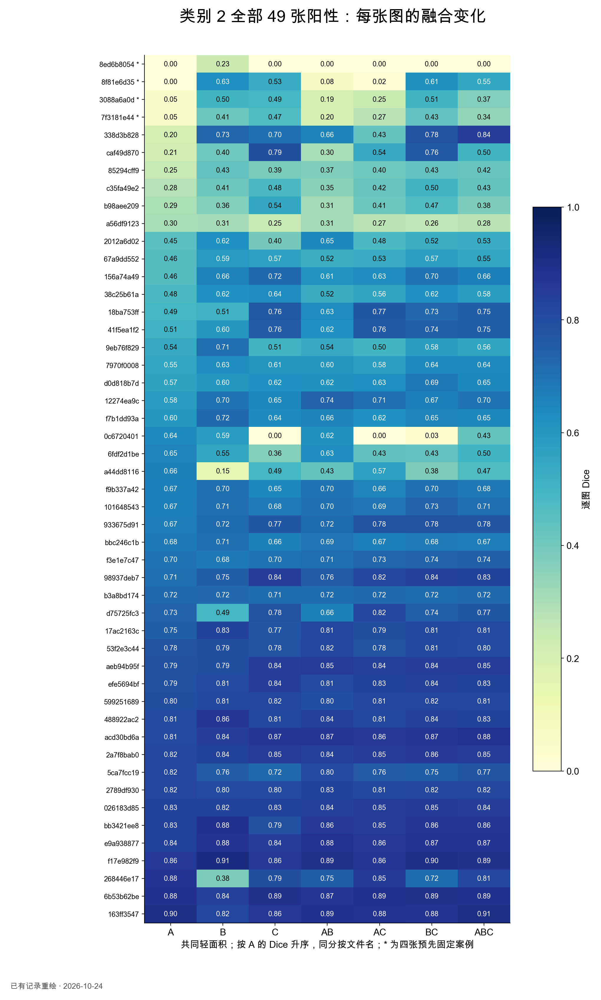

- 观察：同一组合并非对每张图都更好；8ed6b8054 仅 B 保有预测，其他组合为零。
- 口径：全49图版本没有按结果删样本；12图版本按 A 的低 Dice 选取，阅读时配合全量图。
- 来源：`docs/results/E03-r02/class2_positive_comparison.json`
- 文件：[PNG](10_class2_all49.png) · [SVG](10_class2_all49.svg)

## A 最弱的 12 张类别 2 阳性：其他成员带来了什么

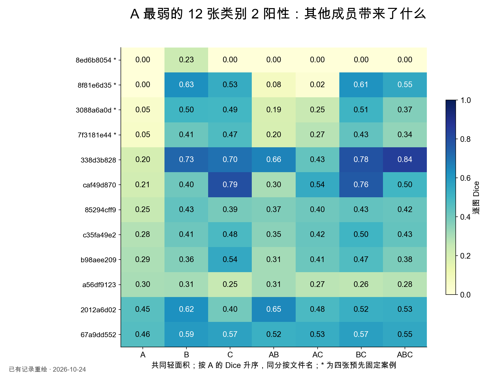

- 观察：同一组合并非对每张图都更好；8ed6b8054 仅 B 保有预测，其他组合为零。
- 口径：全49图版本没有按结果删样本；12图版本按 A 的低 Dice 选取，阅读时配合全量图。
- 来源：`docs/results/E03-r02/class2_positive_comparison.json`
- 文件：[PNG](11_class2_weak12.png) · [SVG](11_class2_weak12.svg)

## ABC 相对 A：净提升背后也有新增误报与定位损失

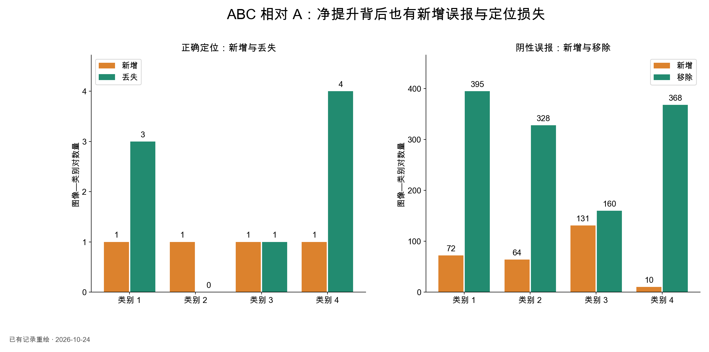

- 观察：类别 2 新增 1 张定位、无旧定位丢失；误报移除 328、新增 64，净少 264。类别 1、4 的定位净减少。
- 口径：定位只要求与真值有像素交集；此图不衡量交集的覆盖质量。
- 来源：`docs/results/E03-r02/summary.json:combinations.ABC.area.vs_A`
- 文件：[PNG](12_gains_losses.png) · [SVG](12_gains_losses.svg)

## 模型看到的概率：8ed6b8054

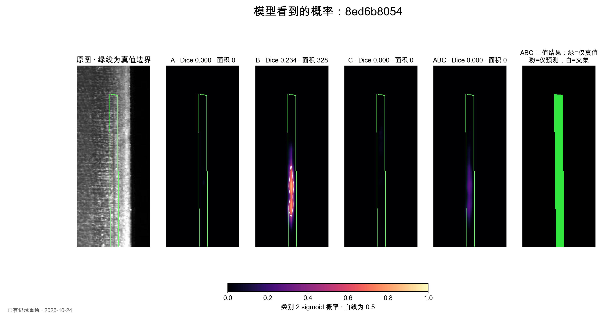

- 观察：仅 B 有正确交集；概率平均后的弱证据没有越过 0.5，面积过滤前即为空。
- 口径：类别 2；原图横坐标裁取 [54, 157)，显示全部真值与各成员 >0.5 预测区域；这是分割概率，不是 Grad-CAM。面积为整张图轻面积过滤后的数量。
- 来源：`raw/runs/E03-r02/reference_probabilities/8ed6b8054.npz`、`docs/results/E03-r02/selected_cases.json`、`raw/data/severstal/train.csv`
- 文件：[PNG](13_probability_8ed6b8054.png) · [SVG](13_probability_8ed6b8054.svg)

## 模型看到的概率：8f81e6d35

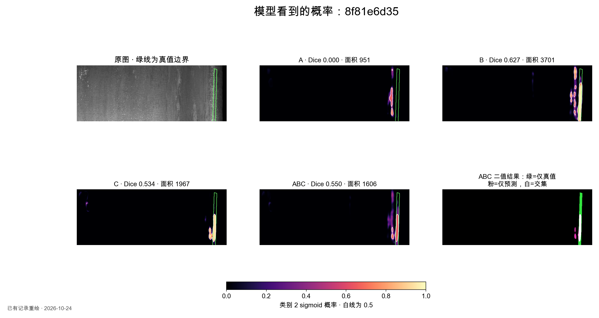

- 观察：不同成员的预测位置和覆盖不同；以真实掩膜及逐图 Dice 判断改善，不只看热力图亮度。
- 口径：类别 2；原图横坐标裁取 [374, 1061)，显示全部真值与各成员 >0.5 预测区域；这是分割概率，不是 Grad-CAM。面积为整张图轻面积过滤后的数量。
- 来源：`raw/runs/E03-r02/reference_probabilities/8f81e6d35.npz`、`docs/results/E03-r02/selected_cases.json`、`raw/data/severstal/train.csv`
- 文件：[PNG](13_probability_8f81e6d35.png) · [SVG](13_probability_8f81e6d35.svg)

## 模型看到的概率：3088a6a0d

- 观察：不同成员的预测位置和覆盖不同；以真实掩膜及逐图 Dice 判断改善，不只看热力图亮度。
- 口径：类别 2；原图横坐标裁取 [49, 154)，显示全部真值与各成员 >0.5 预测区域；这是分割概率，不是 Grad-CAM。面积为整张图轻面积过滤后的数量。
- 来源：`raw/runs/E03-r02/reference_probabilities/3088a6a0d.npz`、`docs/results/E03-r02/selected_cases.json`、`raw/data/severstal/train.csv`
- 文件：[PNG](13_probability_3088a6a0d.png) · [SVG](13_probability_3088a6a0d.svg)

## 模型看到的概率：7f3181e44

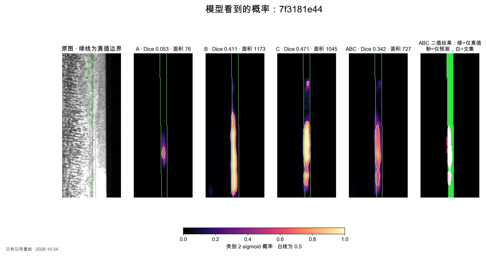

- 观察：不同成员的预测位置和覆盖不同；以真实掩膜及逐图 Dice 判断改善，不只看热力图亮度。
- 口径：类别 2；原图横坐标裁取 [49, 153)，显示全部真值与各成员 >0.5 预测区域；这是分割概率，不是 Grad-CAM。面积为整张图轻面积过滤后的数量。
- 来源：`raw/runs/E03-r02/reference_probabilities/7f3181e44.npz`、`docs/results/E03-r02/selected_cases.json`、`raw/data/severstal/train.csv`
- 文件：[PNG](13_probability_7f3181e44.png) · [SVG](13_probability_7f3181e44.svg)

## 为什么全空预测也能得到 0.8590？

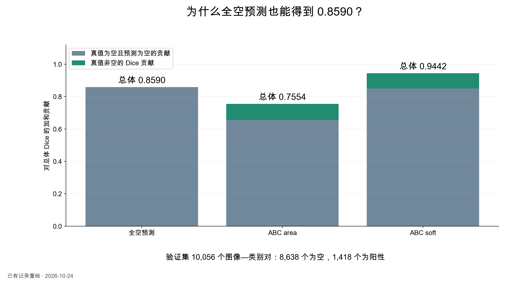

- 观察：空标签占多数。soft 大幅减少误报后总体分上升，但阳性 Dice 由 area 的 0.7103 降至 0.6707。
- 口径：仅分解本地验证分；不能用空预测参照推算官方测试分布。
- 来源：`docs/results/E03-r02/metric_context.json`
- 文件：[PNG](14_metric_decomposition.png) · [SVG](14_metric_decomposition.svg)

## 分类信息的增益，要和固定面积控制一起看

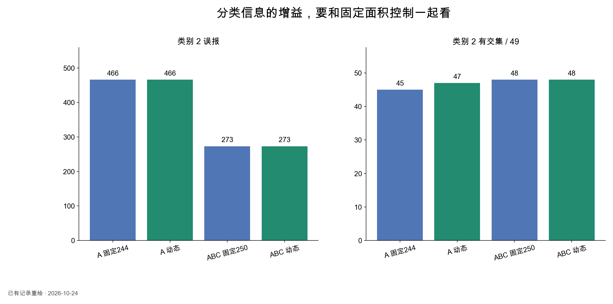

- 观察：A 上相同 466 个误报时，动态多保留 2 张弱定位；ABC 上两分支均为 273 个误报、48 张定位，且逐图结果相同。
- 口径：A 的固定244为事后匹配误报的诊断阈值；ABC 固定250来自既定5倍面积控制，不是同一阈值搜索实验。
- 来源：`docs/results/E04-r01/matched_area_comparison.json`、`docs/results/E03-r02/summary.json`
- 文件：[PNG](15_matched_control.png) · [SVG](15_matched_control.svg)

## 冻结分支接受官方测试：本地结果不等于测试成绩

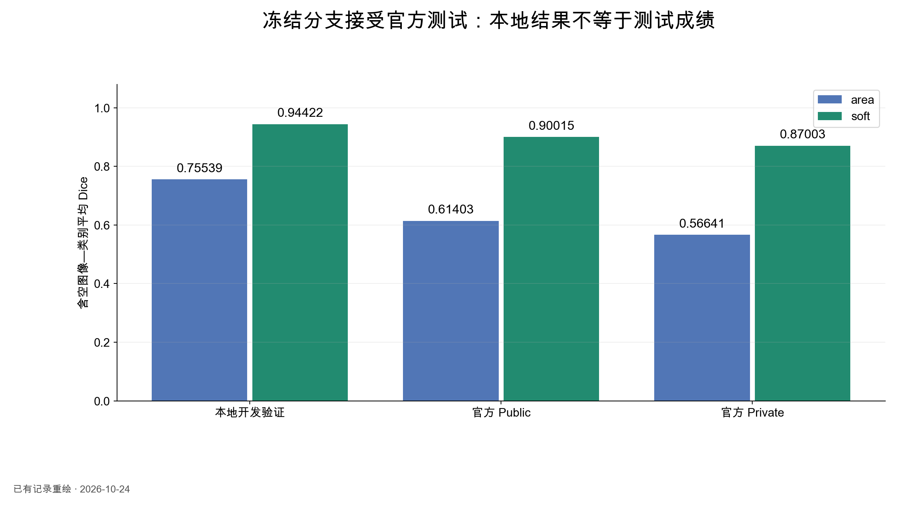

- 观察：soft 的 Private 为 0.87003，高于 area 的 0.56641；两分支都存在本地与官方得分差距。
- 口径：三个横轴为不同数据分区；本地参与选模与开发，官方为赛后提交得分，无追认比赛名次或隐藏集逐类指标。
- 来源：`docs/results/E07-r01/kaggle_scores.json`、`docs/results/E03-r02/summary.json`
- 文件：[PNG](16_official_scores.png) · [SVG](16_official_scores.svg)

## 设备上的实际耗时：保留波动，不用单一估计代替

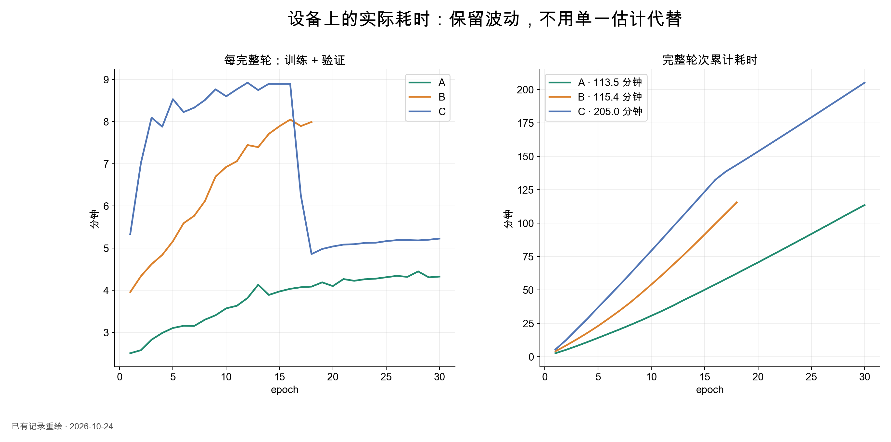

- 观察：各轮耗时明显波动；C 完整30轮累计时间最长。历史记录存在热降频和一次暂停恢复。
- 口径：按完整轮次日志加总，排除暂停间隔、准备阶段和被中断的未完成轮次；不同设备状态和 batch，不能作纯架构速度结论。
- 来源：`raw/runs/E02-r01/history.jsonl`、`raw/runs/E02-r03/history.jsonl`、`raw/runs/E02-r04/history.jsonl`
- 文件：[PNG](17_actual_cost.png) · [SVG](17_actual_cost.svg)

## 总分提高的代价：六张原有正确定位被清空

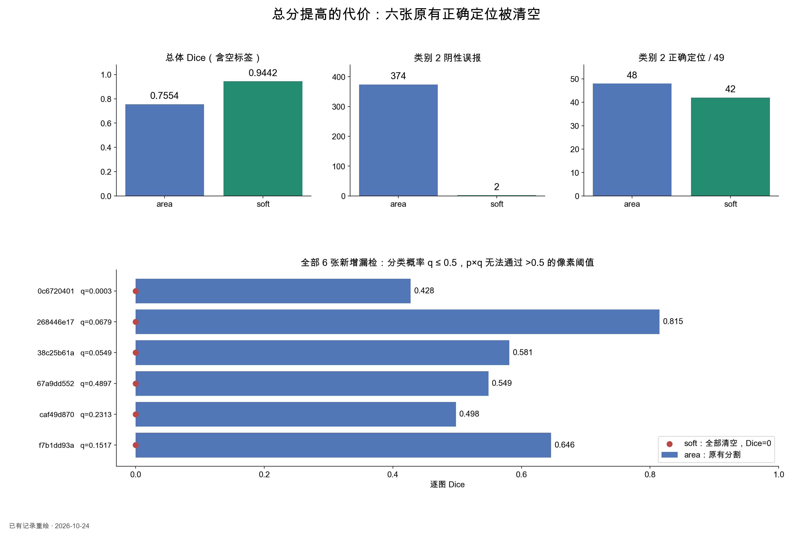

- 观察：本地总体 Dice 0.7554→0.9442，类别2误报374→2；同时正确定位48→42。六张原有分割Dice为0.428至0.815，soft后均为0。
- 口径：同一开发验证集上 area/soft 的对照；六张为全部新增定位丢失，不是挑选的案例。q来自正式第28轮分类器。官方隐藏集没有逐类标签，本图不代表官方漏检数。
- 来源：`docs/results/materials_20261024/abc_soft_class2_losses.json`、`docs/results/E03-r02/summary.json`
- 文件：[PNG](18_score_vs_misses.png) · [SVG](18_score_vs_misses.svg)

## 已有案例与官方凭证

- [分类器误删正确分割](../../E04-r01/cases/268446e17.png)
- [删除阴性误报](../../E04-r01/cases/91222b4c9.png)
- [成功分割](../../E04-r01/cases/163ff3547.png)
- [官方成绩原截图](../../E07-r01/kaggle_official_scores.png)
