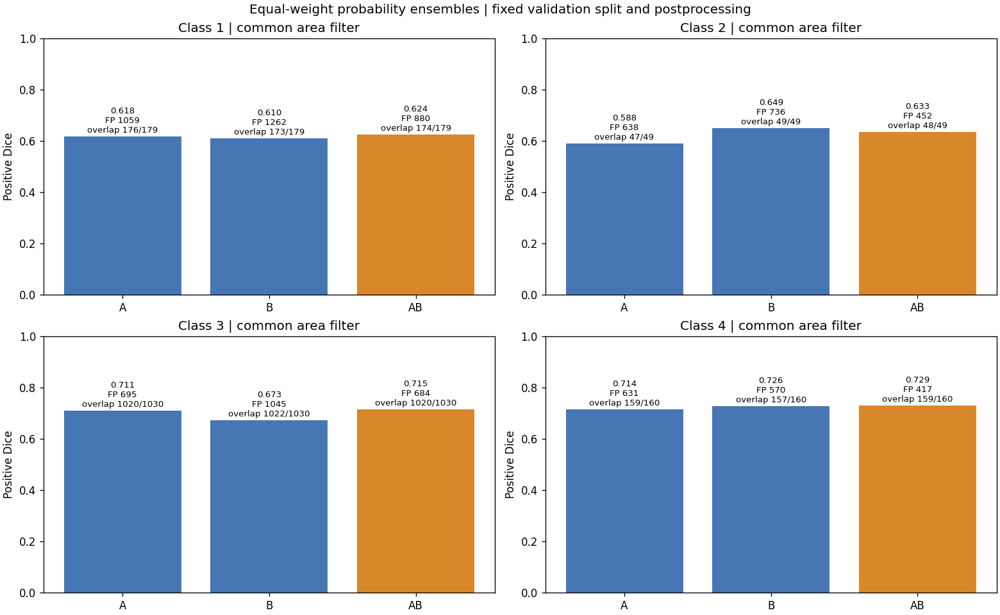

# 实验记录

[项目入口](../README.md) · [当前方案](当前方案.md) · [决策记录](决策记录.md)

2026-10-24 更新：A/B/C 与分类器训练、42 项融合对照及图示核查均完成。E07 两份官方测试也已完成，soft Public/Private 为 0.90015/0.87003。area 保留本地定位参照：非空 Dice 0.7103，类别 2 有交集 48/49、误报 374；B 仍是唯一保有该类 49 个定位的成员。选择与代价见 [D48](决策记录.md#d48)、[D50](决策记录.md#d50)。

## 实验索引

| 编号 | 问题与比较 | 关联决策 | 状态与产物 |
| --- | --- | --- | --- |
| <a id="e01"></a>E01 | 完整公开集成能否加载并生成四类缺陷可视化；核对预处理、融合、TTA 与面积过滤顺序 | D03—D05、D36 | E01-r02 完成；转换比较、摘要及精选图已回传 Mac |
| <a id="e02"></a>E02 | Legion 上按同一划分训练候选分割器与分类器；记录逐成员效果、显存和时间 | D06—D07、D10—D18、D23—D26、D33—D35、D45—D46 | A/B/C 分割与分类器均完成 |
| <a id="e03"></a>E03 | 单体与成员组合相比，新增多少正确检出、误报与耗时 | D09、D19、D21、D45 | E03-r01、E03-r02 全量比较与图示完成 |
| <a id="e04"></a>E04 | 无门控、硬门控、概率相乘、动态面积阈值分别改变了哪些判断 | D08、D13、D21、D40—D44 | E04-r01 完成；融合后的六分支在 E03-r02 完成 |
| <a id="e05"></a>E05 | 整类总面积与连通区域过滤分别删除了噪声还是小缺陷 | D20—D21、D37—D39 | E05-r01/r02 完成中途与最终权重总面积诊断；连通区域比较待做 |
| <a id="e07"></a>E07 | 冻结融合在官方隐藏测试集上的实际成绩及与高分方案的差距 | D49—D50、S14 | E07-r01 完成；soft Public/Private 0.90015/0.87003 |
| <a id="e06"></a>E06 | 类别 2 漏检来自训练暴露不足、阈值还是定位能力；随训练进展复查 | D37—D38 | E06-r01 已完成：裁剪暴露与第 11 轮概率诊断 |

E03—E05 使用同一验证划分做开发比较；该划分用于选模和方法诊断，官方测试成绩见 E07。若先用公开权重做案例探索，在该次记录中标明数据用途。改变实验问题新增编号，同一问题的运行使用 `E02-r01` 等子编号。

## 每次运行记录

<a id="e07-r01"></a>
### E07-r01 · 2026-10-24 · 完成：Kaggle 晚提交

- 用户明确要求提交现有融合；依据 D49、S13—S14，在看到测试分数前固定 area 与 soft 两份对照。保留 A29/B11/C29、分类器 28、原训练划分及全部推理门槛，不追加训练。
- 已核查：Mac/Legion 起始均为 c05c8ea，Legion 空闲、GPU 33°C，本地有 5,506 张测试图；两端没有 Kaggle API 凭证，浏览器账号已登录。通过网页提交，无需生成新凭证。
- 官方网页支持 Late Submission，但为 Kernels-only；需要模型 Dataset 和离线 Notebook 在隐藏数据上重跑。用户已于本轮明确允许接受条款，页面已显示 Rules accepted。
- 实现：`severstal/kaggle_bundle.py` 导出仅推理权重；`severstal/kaggle_infer.py` 复用已有归一化、融合、门控与 RLE；`kaggle/abc_submission.ipynb` 为离线入口。模型包、短检查、版本及提交回执如下。
- 导出与短检查版本 `31b45ad`。仅推理权重共 349,234,260 bytes，含离线依赖和源码的 ZIP 为 327,483,394 bytes；模型包留在两端 `runs/E07-r01/`，不进 Git。原上传缓慢，用户切换热点后同一上传继续完成；14:34:30 创建私有 [模型 Dataset](https://www.kaggle.com/datasets/yuhaowang1937/severstal-abc-frozen-e07-weights)，Initial release 状态 Successful，25 文件。
- 32 张验证图（4 张固定案例 + 验证清单前 28 张）生成每分支 128 行。area 与 E03-r02 预测面积、正确定位全部一致，Dice 最大差 2.87e−8；soft 有 1 对预测面积改变，正确定位不变，最大 Dice 差 0.0001642。该检查重算分类器 batch 1，原评测复用分类 batch 8 的保存概率；不宣称逐位一致，也不把微小变化解释成改进。耗时 3.47 秒，不含模型加载。
- 原始检查：[迁移对照](results/E07-r01/migration_check.json)、[推理环境与权重来源](results/E07-r01/migration_inference_summary.json)。
- **Kaggle 首次运行：**[area](https://www.kaggle.com/code/yuhaowang1937/severstal-abc-frozen-area) 与 [soft](https://www.kaggle.com/code/yuhaowang1937/severstal-abc-frozen-soft) 均为私有 Notebook、GPU T4×2、Internet off，连接同一权重和官方比赛数据。area 第 1 版 `361705697` 于 14:37:50 启动，61.7 秒后在旧数据路径断言失败，未读取测试图；soft 第 1 版也失败。依赖离线安装及模型模块导入已成功。
- **运行修正：**版本 `5bc0597` 只将硬编码输入路径改为在 `/kaggle/input` 中定位官方赛题的 `test_images`；实测路径为 `/kaggle/input/competitions/severstal-steel-defect-detection/test_images`，图像范围仍由平台提供，不改模型或后处理。
- **可见测试推理完成：**area 第 2 版 `361706604`、soft 第 2 版 `361706742` 均成功，分别生成 5,506 图、22,024 行；平台总耗时 561.4/596.4 秒，纯推理 462.36/499.08 秒，峰值分配显存 1,421.01/1,504.55 MiB。配置提供 T4×2，实际程序只使用一张 Tesla T4。原始 [area 摘要](results/E07-r01/kaggle_area_inference_summary.json)、[soft 摘要](results/E07-r01/kaggle_soft_inference_summary.json)保留运行环境及权重来源：PyTorch 2.11.0+cu128、torchvision 0.26.0+cu128、SMP 0.5.0、timm 1.0.22。
- **无标签观察：**area 逐类非空预测 3098/2020/4885/1062，soft 为 485/171/2105/376，总计 11065→3137。分类概率显著抑制非空输出，但可见测试图没有真值，不能据此写成误报下降或定位损失。
- **正式提交：**area 于 14:52:27、soft 于 14:54:04 提交；版本、说明和输出均匹配预先声明的分支。[官方 Submissions](https://www.kaggle.com/competitions/severstal-steel-defect-detection/submissions)两份均为 `Succeeded (after deadline)`，Public 与 Private 都已返回。网页未显示独立提交编号，以 Notebook 版本和时间定位；[成绩回执](results/E07-r01/kaggle_scores.json)按页面五位小数记录，[官方页面截图](results/E07-r01/kaggle_official_scores.png)保留成功状态与两项分数。

| 冻结分支 | 本地开发含空 Dice | 官方 Public | 官方 Private | 类别 2 有交集（仅本地） |
| --- | ---: | ---: | ---: | ---: |
| ABC area | 0.75539 | 0.61403 | 0.56641 | 48/49 |
| ABC soft | 0.94422 | 0.90015 | 0.87003 | 42/49 |

**结果与解释：**

1. 同一组分割权重加入既有 soft 门控后，Public 增加 **0.28612**、Private 增加 **0.30362**。本地已观察到它能显著减少误报并损失部分定位；官方总分确认了这一处理的总体收益，但隐藏标签不可见，不能把总分收益分解成逐类误报或漏检数。
2. area 的本地含空 Dice 0.7554 本已低于本地全空预测的 0.8590。D48 因非空 Dice 与定位保留选择 area；这适合作为定位研究参照，却不足以成为比赛总分主方案。此次官方结果使这一目标差异成为实际结论，D50 明确用途。
3. 本地开发→Public→Private：area 为 0.75539→0.61403→0.56641，soft 为 0.94422→0.90015→0.87003。开发分数没有代表测试水平；分布差异及泛化问题需要进一步研究。仅凭三个汇总分不能判定单一原因，也没有证据证明隐藏集类别 2 优于高分方案。

| 比较对象（S13） | Public | Private | 私榜比我们的 soft 高 |
| --- | ---: | ---: | ---: |
| 冠军正式提交 | 0.92124 | 0.90883 | 0.03880 |
| 第 3 名正式提交 | 0.91863 | 0.90765 | 0.03762 |
| 第 4 名 | 未核定 | 0.90744 | 0.03741 |
| 第 9 名 | 未核定 | 0.90641 | 0.03638 |
| 第 31 名 | 未核定 | 0.90412 | 0.03409 |
| 第 40 名 | 0.91950 | 0.90354 | 0.03351 |
| Karl 正式第 55 名 | 0.91844 | 0.90274 | 0.03271 |
| Lightforever 公开三模型记录版本 | 0.90672 | 0.88780 | 0.01777 |

来源与版本定位见 [S13](../Severstal调研/01_高分方案设计依据原始材料.md#s13)。对比使用同一比赛、同一 Public/Private 字段；本轮是赛后提交，不追认名次。我们的 soft 尚无成绩优势，公开推理约 8.3 分钟也不能证明比原高分方案更快，因为硬件和运行条件不同。

**结论与下一步：**以 ABC soft 作为本轮比赛成绩参照，ABC area 保留定位对照；完整交代门控收益与类别 2 代价。优先在现有开发验证材料中研究分类低置信但分割有真实定位的样本，检验怎样减少门控误删，同时控制阴性误报；B 独有弱定位与类别 4 面积误删继续保留。本轮不追加训练、阈值搜索或按私榜反馈再次提交。研究候选与实际执行分开，见 [D50](决策记录.md#d50)。

### E02-r03/r04、E03-r01 · 2026-10-23 · 计划：异构成员与融合

- 依据：D45 恢复原定跨方案融合主线。B 为 `configs/fpn_seresnext50.yaml`，C 为 `configs/unet_efficientnet_b3.yaml`；均用 ImageNet 编码器初始化和 `data/split_seed42.json` 的 10,054/2,514 原图划分，完整训练配置按既有继承关系执行。
- 顺序：先 B，形成 A/B/A+B 对照；再 C，补齐三种单体、三种两两组合与 A+B+C。概率图按图像、类别和像素对齐后等权平均，再共同使用像素阈值 0.5 和面积参照 100/50/200/400；原始未过滤结果同时保留。公开三模型的 logits/TTA 原流程不改变。
- 评价：整体与阳性 Dice、逐类误报/空预测漏检/有交集数、成员新增正确定位和新增误报、推理耗时。固定保留 E04 的四张类别 2 失败图作为案例；完整验证集结果决定成员去留。
- 后续：在融合概率上复查已实现门控，再依据剩余错误决定是否训练裁剪改进。实际代码版本、配置、耗时与产物在对应运行中补记；当时尚无 B/C 最终成绩或自主融合成绩。

### E02-smoke03 · 2026-10-23 16:29—16:32 · 失败：FPN 官方权重直连

- 版本 `d48ac65`，配置 `configs/fpn_seresnext50.yaml`，拟运行 8 个训练 batch、16 张验证图；源配置 batch 2、ImageNet 编码器。
- 实际停在 Hugging Face `config.json` 下载，报 `[Errno 101] Network is unreachable`；没有进入训练或产生指标。结束本次重试，原日志保留于 Legion `runs/setup/E02-smoke03.log`。
- 处理：Mac 下载 SMP 指定的官方 revision，转存 `weights/huggingface/` 后重跑为 E02-smoke03b。权重版本与加载方式见 D46；本次没有更换初始化来源。

### E02-smoke03b · 2026-10-23 17:06 · 完成：FPN 离线初始化与短运行

- 版本 `9601fc2`，实际设置与首次短检查一致；通过 `HF_HOME=weights/huggingface`、`HF_HUB_OFFLINE=1` 加载官方权重。B 与 C 的初始化包均已转存。
- 8 个训练 batch 用时 1.97 秒，16 图验证 0.83 秒，峰值显存 864.37 MiB，反向传播与保存正常。非空 Dice 0.0741 仅为连通检查，不能当作性能结论；这 16 张验证图中没有类别 2 阳性。
- 产物：Legion `runs/E02-smoke03b/`、`runs/setup/E02-smoke03b.log`；Mac [容量指标](results/E02-r03/smoke_metrics.json)。采用原 batch 2，进入完整训练。

### E02-r03 · 2026-10-23 17:07—19:02 · 完成：FPN + SE-ResNeXt50

- 问题：作为第二个异构成员，能否补充 A 的定位并改善融合，关联 D11、D45—D46。沿用 `configs/fpn_seresnext50.yaml`，版本 `9601fc2`，启动副本干净。
- 数据与初始化：固定 10,054/2,514 划分，ImageNet SE-ResNeXt50 官方 revision 见 D46。256×512 裁剪训练、256×1600 全图验证，batch 2、AMP；损失、增强、AdamW 与学习率设置继承 A 的起点。
- 预算：上限 30 轮，连续 7 轮非空 Dice 无改善停止；按非空 Dice 保存最佳权重。首个 epoch 完成后记录实际耗时，不用短运行外推最终指标。
- 运行：原 PID `68475`，日志 `runs/setup/E02-r03.log`，目录 `runs/E02-r03/`；18 轮后正常结束，训练期间副本保持 `9601fc2`。
- 原始材料：[启动配置与版本](results/E02-r03/start.jsonl)。训练结束后先运行 E03-r01，再启动 C。
- 首轮观察：非空 Dice 0.5594、整体 Dice 0.4564；类别 2 仍为空预测 49/49，其他类已经产生定位。先保持既定训练，不能用首轮判断最终互补性，也不插入裁剪或门控调参。训练 197.00 秒、验证 40.21 秒，约 3.95 分钟/轮；若速度不变，30 轮约 119 分钟，不含后续评测。原始指标见[第 1 轮](results/E02-r03/epoch01.json)。
- 第 2 轮：总体非空 Dice 升至 0.6031；类别 2 的 18/49 张阳性图产生非空预测，空预测漏检 31、阴性误报 236、阳性 Dice 0.0625。相较 A 前 11 轮仍全空，B 的稀有类学习起步不同，但非空不等于定位正确；最终互补性仍由 E03 判断。训练加验证 259.83 秒，保持原训练设置。原始指标见[第 2 轮](results/E02-r03/epoch02.json)。
- 第 3 轮：总体非空 Dice 0.6194，类别 2 阳性 Dice 0.5947、49/49 非空、48/49 有交集，误报 1119。固定四图均有交集：`3088a6a0d`/`7f3181e44` 的 Dice 为 0.6711/0.6069（A 最终约 0.0462/0.0526）；`8ed6b8054`/`8f81e6d35` 为 0.0490/0.5616（A 最终均为 0）。这首次提供 B 可能补足 A 的直接样本证据，但误报很多，且它不是最终选中的 B 权重；继续完成训练，再以正式 A/B/A+B 对照决定。见[第 3 轮指标](results/E02-r03/epoch03.json)、[固定案例核查](results/E02-r03/epoch03_class2_review.json)。
- 第 4—5 轮：总体非空 Dice 先回落至 0.5378，再升至新最佳 0.6335；第 5 轮类别 2 阳性 Dice 0.6140、误报 1267、空预测漏检 1。误报仍高，继续预定训练与后续融合；没有因单轮回落修改配置。完整变化见[逐轮历史](results/E02-r03/history.jsonl)，该文件随后续进展更新。
- 第 6—8 轮：总体非空 Dice 分别为 0.6335、0.5978、0.6151，未超过第 5 轮；第 8 轮后预设调度器将学习率降至 1.5e-4。类别 2 第 6 轮误报降到 349，但阳性 Dice 也降至 0.5027；第 8 轮为误报 615、阳性 Dice 0.5745、空预测漏检 2，不能只按误报下降判断改善。第 8 轮训练加验证 366.71 秒（6.11 分钟），首轮约 119 分钟的总时长估计已偏乐观。17:49 设备读数为 88°C、450 MHz、利用率 97%，`SW Thermal Slowdown=Active`，说明持续热降频影响耗时；峰值分配显存仍约 864 MiB。保持既定训练和选模规则。
- 第 9—10 轮：非空 Dice 从 0.6289 升至新最佳 0.6598；第 10 轮类别 2 阳性 Dice 0.6509、误报 490、空预测漏检 2。相对第 5 轮，类别 2 的轮廓质量和误报同时改善。该变化出现在预设学习率下降后，没有人工插入改参；尚不能将变化单独归因为调度。保持原训练预算，当前最佳更新到第 10 轮。见[第 10 轮指标](results/E02-r03/epoch10.json)。
- 第 11 轮：非空 Dice 更新至 0.6701；类别 2 阳性 Dice 0.6493、误报 818。逐图复查确认 **49/49 阳性图均有真实交集**，不只是预测非空；A 最终为 47/49。保存[49 张逐图结果](results/E02-r03/epoch11_class2_review.json)作为早期互补性证据，仍按总体非空 Dice 选最终 B 权重，不在中途更换选模目标。
- 第 12—13 轮：非空 Dice 分别为 0.6519、0.6435；类别 2 阳性 Dice 0.6039、0.5974，误报 904、1094，空预测漏检均为 0，未更新最佳权重。
- 第 14—15 轮：非空 Dice 为 0.6470、0.6487，仍低于第 11 轮；第 14 轮后预设调度器将学习率降至 7.5e-5。类别 2 阳性 Dice 为 0.5871、0.6694，误报 641、829，空预测漏检 2、1。第 15 轮类别 2 轮廓分数更高，但整体未改善、仍有空预测，因此不改为按类别 2 选权重。训练加验证分别 462.44、473.34 秒（7.71、7.89 分钟）；保留实际耗时，不再沿用首轮速度外推。18:40 第 16 轮正在运行，最佳仍为第 11 轮，融合接续脚本仍在等待训练正常结束。原始指标见[逐轮历史](results/E02-r03/history.jsonl)。
- 第 16 轮：整体 Dice 升至 0.7218，非空 Dice 为 0.6611，仍未超过第 11 轮。类别 2 阳性 Dice 0.6337、误报 353、空预测漏检 1；比第 15 轮少 476 个误报，但阳性 Dice 下降 0.0356，类别 1 空预测漏检也增至 8。这轮体现误报减少与缺陷覆盖的取舍，整体 Dice 上升不等于阳性定位全面改善；保持既定非空 Dice 选模，未替换最佳权重。训练加验证 482.76 秒（8.05 分钟）。18:47 第 17 轮正在运行，融合脚本继续等待，未重复启动评测。
- 第 17 轮：非空 Dice 0.6369，类别 2 阳性 Dice 0.6382、误报 756、空预测漏检 2。第 16 轮的低误报未持续，最佳仍为第 11 轮；连续 6 轮未改善，预设调度器将学习率降至 3.75e-5。训练加验证 473.50 秒。18:57 第 18 轮正在运行，继续原定早停，不更换目标或增加训练预算；A/B 评测接续脚本仍正常等待。

- 最终：第 18 轮非空 Dice 0.6648，连续 7 轮未超过第 11 轮，按预设规则早停。18 轮训练加验证共 6923.20 秒（115.39 分钟）；峰值分配显存 864.37 MiB。正式采用第 11 轮，非空 Dice 0.6701、类别 2 阳性 Dice 0.6493、误报 818、空预测漏检 0、49/49 有交集；见[最佳指标](results/E02-r03/best_metrics.json)。随后自动完成 E03-r01。

### E03 实现 · 2026-10-23—24 · 两阶段评测与图示均完成

- `severstal/evaluate_ensemble.py` 与 `configs/ensemble_ab.yaml`、`ensemble_abc.yaml` 已实现；A/B 三组合、A/B/C 七组合均保存逐图对照。成员在相同全图输入上各前向一次，概率平均后再共同过滤。
- 新增针对性检查：概率平均与 logits 平均不能混淆，成员张量尺寸必须一致，逐图统计须分别计入救回、丢失、增加误报、删除误报。Mac 语法检查与 Legion `tests/test_ensemble.py` 的 3 项检查通过（2.34 秒）；A/B 与七组合全量评测均已完成，见下方 E03-r01/r02。
- `severstal/ensemble_figures.py` 生成逐类比较图与四张预先选定的类别 2 失败图；在 A/B/C 结果上沿用同一批案例。E03-r01/r02 比较图与四张固定案例均已生成并逐张目视检查。
- 顺序衔接：Legion `runs/setup/continue_E03_r01.py`（原 PID `69168`）已在 FPN 正常结束后检查完成标记，将空闲副本快进至评测版本 `d022a39`，完成 E03-r01 和图示。日志为 `runs/setup/E03-r01.pipeline.log`；FPN 失败则不继续，B3 不由此脚本启动，须先分析 A/B/A+B 结果。
- 持续推进：Codex 当前聊天的自动跟进“Severstal 融合实验推进”（ID `severstal`）原每 10 分钟检查训练与产物；10 月 23 日 21:34 随用户中止请求改为 PAUSED，10 月 24 日 10:20 按“继续”请求恢复 ACTIVE。E03-r01、B3 正式训练及 E03-r02 七组合六分支现已全部完成；每批文档修改执行 neat-freak，本轮收尾后删除自动跟进并保留聊天。只在阶段完成、重要结果变化、异常或需用户操作时通知。该跟进不替代 Legion 的训练日志与实际产物核验。

### E03-r01 · 2026-10-23 19:03—19:06 · 完成：A/B/A+B 融合对照

- 依据与输入：D45—D46；评测版本 `d022a39`，配置 `configs/ensemble_ab.yaml`。A 为 E02-r01 第 29 轮（`d0c1e67`），B 为 E02-r03 第 11 轮（`9601fc2`）；固定 2514 张验证原图，概率等权平均、阈值 0.5，无 TTA。统一面积 100/50/200/400；本阶段未使用分类器，也未为组合调参。
- 总耗时 172.95 秒；A/B 的 GPU 前向与 sigmoid 分别 66.49/80.52 秒，约 26.45/32.03 毫秒/图。该计时不含加载与分类器，不作为完整部署时延。峰值分配显存 571.57 MiB。

| 成员 | 处理 | 整体 Dice | 非空 Dice |
| --- | --- | ---: | ---: |
| A | raw | 0.5898 | 0.6951 |
| A | area | 0.6564 | 0.6951 |
| B | raw | 0.5450 | 0.6701 |
| B | area | 0.5942 | 0.6701 |
| AB | raw | 0.6696 | 0.7022 |
| AB | area | 0.7160 | 0.7019 |

共同面积过滤后的逐类结果；空漏检仅指预测为空，有交集另计：

| 类别 | 成员 | 整体 Dice | 阳性 Dice | 误报 | 空漏检 | 有交集/阳性 |
| --- | --- | ---: | ---: | ---: | ---: | ---: |
| 1 | A | 0.5516 | 0.6179 | 1059 | 2 | 176/179 |
| 1 | B | 0.4703 | 0.6102 | 1262 | 2 | 173/179 |
| 1 | AB | 0.6232 | 0.6241 | 880 | 4 | 174/179 |
| 2 | A | 0.7382 | 0.5884 | 638 | 1 | 47/49 |
| 2 | B | 0.7004 | 0.6493 | 736 | 0 | 49/49 |
| 2 | AB | 0.8131 | 0.6334 | 452 | 1 | 48/49 |
| 3 | A | 0.6050 | 0.7107 | 695 | 2 | 1020/1030 |
| 3 | B | 0.4502 | 0.6727 | 1045 | 1 | 1022/1030 |
| 3 | AB | 0.6110 | 0.7146 | 684 | 2 | 1020/1030 |
| 4 | A | 0.7308 | 0.7140 | 631 | 0 | 159/160 |
| 4 | B | 0.7559 | 0.7263 | 570 | 3 | 157/160 |
| 4 | AB | 0.8169 | 0.7286 | 417 | 1 | 159/160 |

- **融合收益：**B 单体非空 Dice 低于 A，A+B 仍提高到 0.7019（较 A +0.0068）。四类阳性 Dice 均超过 A，误报分别减少 179/186/11/214；支持按组合实测判断成员价值。类别 2 的 186 个净减少由删除 242 个原误报、增加 56 个新误报构成，不是全部旧误报都消失。
- **定位取舍：**A+B 相对 A 的逐类新增/丢失交集为 1/3、1/0、0/0、1/1。类别 1 有交集 176→174，类别 4 总数相同但样本发生替换；不能把净数不变写成全部保留。类别 2 从 47→48，仍少于 B 的 49。raw 的类别 1/3/4 有交集为 176/1021/160，面积过滤后为 174/1020/159，说明 A 上选定的面积门槛迁移到组合时会删掉真实小预测；本轮保留共同门槛完成可比对照，未据此临时调参。

固定四图的全量评测 Dice（按 A/B/AB）：

| 类别 2 样本 | A | B | AB | 图示观察 |
| --- | ---: | ---: | ---: | --- |
| `8ed6b8054` | 0 | 0.2344 | 0 | B 在左侧窄条上有定位，等权平均后消失；raw 已为空，非面积过滤造成。 |
| `8f81e6d35` | 0 | 0.6273 | 0.0759 | A 画在真实窄条左侧；B 覆盖真实条带，AB 只补回小段，仍保留部分错位预测。 |
| `3088a6a0d` | 0.0462 | 0.4993 | 0.1919 | A 仅有碎片，B 覆盖更多纵向缺陷；AB 有改善但明显少于 B。 |
| `7f3181e44` | 0.0526 | 0.4106 | 0.1964 | 与上一张呈相似竖向边缘外观；AB 扩大覆盖，仍未保住 B 的全部轮廓。 |

- **数值复算：**A/B 阳性逐对 Dice 最大差异 0.00147/0.00255，有交集计数均未变。B 的类别 4 一张阴性图 `b5ab7a42f` 从 2 像素变为空，导致该对 Dice 差 1、误报 787→786；没有阳性定位翻转。符合混合精度及 cuDNN 算法选择下阈值附近的数值波动，具体算子原因未隔离；本表统一引用同一次 E03 复算。[核查原始记录](results/E03-r01/raw_reproduction_review.json)
- **图示核查与修正：**四张图已查看，红色预测与绿色真值边界清楚。首次用 float16 保存案例概率，重绘有 1—2 像素差异（如 B 的 `8ed6b8054` 为 326，对应正式评测 328）；图标题补充近似说明，答辩表格引用全量评测值。后续 E03-r02 保留原 float32 案例概率，避免保存环节再次量化；不重训或重跑已完成的全量比较。[图示数值核查](results/E03-r01/case_rendering_review.json)
- **结论与下一步：**保留 B 和 A+B 作为七组合候选；B 的弱单体分数没有否定其互补性，A+B 也没有保住 B 的全部定位。按 D47 进入原定 C：U-Net + EfficientNet-B3，先短运行再完整训练，完成后统一比较七组合和六种既有门控。本轮是同一开发验证划分的结果，尚无独立测试结论。
- **产物：**Legion `runs/E03-r01/` 保留完整逐图记录及四图概率；Mac 保存[摘要](results/E03-r01/summary.json)、[新增与丢失样本](results/E03-r01/changed_cases.json)、[类别 2 的 49 张逐图结果](results/E03-r01/class2_positive_comparison.json)、[四图索引](results/E03-r01/selected_cases.json)。



案例：[原始空预测](results/E03-r01/cases/8ed6b8054.png) · [原始错位预测](results/E03-r01/cases/8f81e6d35.png) · [欠分割一](results/E03-r01/cases/3088a6a0d.png) · [欠分割二](results/E03-r01/cases/7f3181e44.png)

### E02-smoke04 · 2026-10-23 19:13 · 完成：B3 容量检查

- 干净版本 `c7427ab`，官方 ImageNet 离线缓存初始化，batch 2；8 个训练 batch 用时 3.13 秒、16 图验证 1.48 秒，峰值分配显存 765.73 MiB。反向传播、验证与保存均正常。
- 非空 Dice 0.1597 仅为连通检查，这 16 张图没有类别 2 阳性，不能据此判断性能。保持原配置启动完整训练。Legion `runs/E02-smoke04/`；Mac [容量指标](results/E02-r04/smoke_metrics.json)。

### E02-r04 · 2026-10-23—24 · 完成：U-Net + EfficientNet-B3

- 依据 D12、D45、D47：在 A/B 互补已确认且弱定位仍会被平均削弱的条件下，检验第三种骨干带来的增量，不预设三模型一定更好。
- 配置 `configs/unet_efficientnet_b3.yaml`；沿用 seed 42、10,054/2,514 划分、256×512 裁剪和全图验证、batch 2、AMP、既有损失与优化器、30 轮上限、patience 7、非空 Dice 选模。官方 ImageNet revision 与离线缓存见 D46。
- 容量检查通过后从 ImageNet 重新初始化完整训练，不接着训练短运行权重。初次启动版本 `c7427ab`，副本干净；原 PID `76540`，日志 `runs/setup/E02-r04.log`，产物 `runs/E02-r04/`。启动记录显示完整 10,054/2,514 图、30 轮预算、非空 Dice 选模；已确认第 1 轮实际批次推进。见[启动配置与版本](results/E02-r04/start.jsonl)。
- 训练期间保持 Legion 工作副本不变；训练与自动跟进已于 10 月 24 日恢复，正常完成才执行 `configs/ensemble_abc.yaml` 的 E03-r02 和图示检查，不重跑 E03-r01。

- **暂停前训练观察：**第 1—7 轮类别 2 几乎没有正确轮廓；第 6 轮后预设学习率降至 1.5e-4，第 8 轮阳性 Dice 0.2574，第 12 轮升至 0.6287、空预测漏检 0。暂停时最佳第 15 轮总体非空 Dice 0.6745，类别 2 阳性 Dice 0.6473、误报 1484、空预测漏检 1；后两轮总体未超过最佳。不同于 B 较早出现定位，C 的类别 2 起步较迟、当前误报仍多；尚无 C 融合结果，不据单体分数改变候选。完整[逐轮历史](results/E02-r04/history.jsonl)保留；[最佳指标](results/E02-r04/best_metrics.json)随续训更新。
- **暂停原因与位置：**21:30 用户询问发热，实测 GPU 88°C、利用率 85%、温度降频已触发；21:34 用户要求安全中止。停止前以 CPU 完整加载 `last.pt`，确认已完成第 17 轮且包含模型、优化器、调度器、AMP 和随机状态；第 15 轮 `best.pt` 也可读取。随后结束 PID `76540` 及其数据读取子进程，暂停自动跟进，未关闭操作系统或删除任何结果。[暂停记录](results/E02-r04/pause_record.json)
- **保留与损失：**17 轮训练加验证共 138.62 分钟；第 18 轮已开始约 700/5027 批次，这部分未落盘进度需重做。恢复入口仍为原配置、原目录加 `--resume`，从第 18 轮开始，预算仍为总计最多 30 轮、原 patience 7。第 15 轮仅为暂停时最佳，不能称为已完成训练的正式最终模型。
- **停止核验：**GPU 计算进程列表为空，项目训练和评测进程均已退出；随后温度降至 72°C、显存仅 15 MiB。当时训练副本保留在 `c7427ab`，训练与七组合均停止等待用户恢复。

- **2026-10-24 10:20 恢复：**用户明确要求“继续”。检查时 GPU 30°C、无其他计算进程，训练副本仍为干净 `c7427ab`，检查点与 17 轮历史完整。以原配置、原目录加 `--resume` 启动，PID `9707`；新日志 `runs/setup/E02-r04.resume01.log`，保留昨日原日志。
- **恢复验证与预算：**启动事件为 `resume=true`、完整 10,054/2,514 图、非短运行；已看到第 18 轮实际批次推进。模型、优化器、学习率调度、AMP 和随机状态从 `last.pt` 恢复；总预算仍为 30 轮、patience 7。没有重新做容量检查或从 ImageNet 重训。原始事件见[启动及续训记录](results/E02-r04/run_events.jsonl)。自动跟进恢复为 ACTIVE，继续 D47 的七组合与既有门控顺序。

- **第 18—19 轮（10 月 24 日 10:32 核查）：**第 18 轮非空 Dice 0.6712，预设调度器将学习率降至 7.5e-5；第 19 轮成为新最佳 0.6823。类别 2 阳性 Dice 分别 0.6169/0.6278、误报 1451/873、空预测漏检 0/1。相对暂停时最佳第 15 轮，第 19 轮整体非空 Dice 提高 0.0078、类别 2 少 611 个误报，但该类阳性 Dice 下降约 0.0195；继续按四类非空 Dice 选模，不把局部取舍写成全面改善。两轮训练加验证分别 291.40/298.58 秒（4.86/4.98 分钟）；第 20 轮正常运行，保留原调度与预算，七组合待完整训练结束。

- **第 20—21 轮（10 月 24 日 10:42 核查）：**非空 Dice 为 0.6675/0.6745，最佳仍为第 19 轮。类别 2 阳性 Dice 0.6065/0.5881、误报 883/585、空预测漏检 3/2。第 21 轮整体 Dice 升至 0.7245，但类别 1 阳性 Dice 仅 0.4230、空漏检 23；误报减少并不代表各类缺陷覆盖一起改善，因此仍按既定非空 Dice 选模。两轮训练加验证 302.15/304.79 秒（5.04/5.08 分钟），第 22 轮正常运行；未改变配置或提前启动融合。

- **第 22—25 轮（10 月 24 日 11:02 核查）：**总体非空 Dice 依次 0.6752/0.6795/0.6869/0.6782，第 24 轮更新最佳。第 22 轮后预设学习率降至 3.75e-5；类别 2 阳性 Dice 依次 0.6640/0.6392/0.6237/0.6524，误报 831/522/505/567，空预测漏检 0/1/1/1。当前最佳第 24 轮较第 19 轮总体提升 0.0046，类别 2 误报少 368、阳性 Dice 小降 0.0041；第 22 轮该类 Dice 更高且无空预测，但整体未胜出，仍保留原选模规则。各轮训练加验证 305.41—309.71 秒，约 5.09—5.16 分钟；第 26 轮正常运行。尚未产生 C 的融合成绩，不据中途单体指标改变七组合计划。

- **第 26—27 轮（10 月 24 日 11:12 核查）：**非空 Dice 连续更新为 0.6883/0.6947，当前最佳第 27 轮。类别 2 阳性 Dice 0.6459/0.6433、误报 945/647、空预测漏检均为 0。相对第 24 轮，第 27 轮类别 2 阳性 Dice 提高约 0.0195、少 1 个空漏检，但多 142 个误报；类别 1 阳性 Dice 升至 0.5851、空漏检从 9 减至 2。记录这些具体取舍，不将类别 2 的非空输出直接称为正确定位。两轮训练加验证均约 311.2 秒（5.19 分钟）；第 28 轮继续运行，训练上限仍为 30 轮，完整结束后进入七组合及门控比较。

- **第 28—29 轮（10 月 24 日 11:22 核查）：**非空 Dice 为 0.6924/0.6984，第 29 轮成为新最佳。类别 2 阳性 Dice 为 0.6460/0.6553、误报 625/580、空预测漏检 0/1。相对第 27 轮，第 29 轮总体和类别 2 阳性 Dice 分别提高约 0.0037/0.0120，类别 2 误报少 67，但多 1 个空漏检；其是否由其他成员补回，留待七组合逐图对照。两轮训练加验证分别 310.79/311.77 秒；第 30 轮正常运行，尚未将中途最佳记为正式选模结果。

- **正式完成与选模：**10 月 24 日 11:26 第 30 轮结束，日志出现 `complete`，13:18 核查训练及数据进程均已退出。第 30 轮非空 Dice 0.6864，未超过第 29 轮 0.6984；类别 2 阳性 Dice 降至 0.5776、空漏检增至 5，即使误报降到 413，也不替换原选模结果。正式第 29 轮类别 2 阳性 Dice 0.6553、误报 580、空漏检 1、有真实交集 47/49；未定位图为 `8ed6b8054.jpg`（空预测）和 `0c6720401.jpg`（445 像素预测位于错误位置）。全体 30 轮训练加验证 205.04 分钟，其中恢复后的 13 轮 66.42 分钟；不含暂停和已丢弃的未完整轮次。峰值显存 766.59 MiB。保留原训练设置，进入已授权七组合比较。[完成核查](results/E02-r04/completion_review.json)

<a id="e03-r02"></a>
### E03-r02 · 2026-10-24 · 完成：七种成员组合与六种门控

- **问题与依据：**承接 D47，B 单体较弱却对 A 有补充，C 单体略高于 A 仍不代表集成必然更好。比较 A/B/C/AB/AC/BC/ABC，检查每个成员对定位、轮廓和误报的贡献。依据仍为 S02/S09 的互补实践及 S11 的反例，本轮没有新增文献调研。
- **执行与版本：**13:18 确认 C 正常完成、无项目任务且副本干净后，快进到 `97e8c87`；评测主 PID `17241`，日志 `runs/setup/E03-r02.log`，产物 `runs/E03-r02/`，约 13:21 全量完成。A/B/C 的训练版本为 `d0c1e67`/`9601fc2`/`c7427ab`，正式轮次 29/11/29；分类器第 28 轮。没有重跑旧 E03-r01。
- **固定设置：**`configs/ensemble_abc.yaml`，2,514 张原始验证图；等权平均 sigmoid 概率，像素 0.5、共同面积 100/50/200/400，raw/area/fixed5/hard/soft/dynamic 共 42 项，无 TTA，不为组合分别调参。完整[42 项与逐类比较表](results/E03-r02/comparison_tables.md)、[原始汇总](results/E03-r02/summary.json)、[逐图增损核查](results/E03-r02/comparison_review.json)已保存；完整逐图记录与案例概率留在 Legion。

**共同面积比较：**

| 组合 | 非空 Dice | 类别 2 阳性 Dice | 类别 2 误报 | 空漏检 | 有交集/49 |
| --- | ---: | ---: | ---: | ---: | ---: |
| A | 0.6951 | 0.5883 | 638 | 1 | 47 |
| B | 0.6701 | 0.6493 | 736 | 0 | 49 |
| C | 0.6983 | 0.6553 | 465 | 1 | 47 |
| AB | 0.7019 | 0.6335 | 452 | 1 | 48 |
| AC | 0.7084 | 0.6297 | 303 | 2 | 47 |
| BC | 0.7012 | 0.6709 | 381 | 1 | 48 |
| ABC | 0.7103 | 0.6683 | 374 | 1 | 48 |

**成员贡献与代价：**ABC 非空 Dice 0.7103 为共同面积下最高，较 A 提高 0.0152，四类阳性 Dice 均高于 A；类别 2 新增定位 `8f81e6d35.jpg`，无原有定位丢失，误报新增 64、移除 328，净减少 264。相对 AB，ABC 类别 2 定位仍为同一批 48 张，阳性 Dice 0.6335→0.6683；误报新增 58、移除 136，净减少 78。收益主要是已有轮廓改善与误报减少，没有补回第 49 张。

ABC 不是所有目标都最好：相对 A，类别 1 定位新增 1/丢失 3，类别 3 新增 1/丢失 1，类别 4 新增 1/丢失 4；相对 AB，类别 4 再丢 3 张。共同面积 400 在 ABC 上删掉 `61457b567`、`bb65f4269`、`f4495532f` 的 243/218/307 像素弱定位，因此 ABC raw 的类别 4 为 159/160，area 为 156/160。统一阈值保证比较一致，却不等于各成员均无损。未因此临时调参。

AC 的整体非空 Dice 0.7084 接近 ABC，类别 2 误报更少（303），但定位为 47：相对 A 补到 `8f81e6d35`，同时丢掉 `0c6720401`，不能把相同数量当成相同样本。BC 的类别 2 阳性 Dice 0.6709 最高，定位 48、误报 381；它在该类轮廓略优于 ABC，但整体非空 Dice 0.7012 较低。B 是唯一保有 49 个类别 2 定位的成员，代价是更多误报。四类非空总分按阳性对平均，类别 3 占 1030/1418，不能用总分代替稀有类判断。

**门控结论：**ABC 六分支如下，其他组合的完整对照见上述比较表。

| 分支 | 整体 Dice | 非空 Dice | 类别 2 阳性 Dice | 类别 2 误报 | 有交集/49 |
| --- | ---: | ---: | ---: | ---: | ---: |
| raw | 0.7179 | 0.7104 | 0.6683 | 443 | 48 |
| area | 0.7554 | 0.7103 | 0.6683 | 374 | 48 |
| fixed5 | 0.8146 | 0.7054 | 0.6683 | 273 | 48 |
| hard | 0.9440 | 0.6741 | 0.5966 | 4 | 42 |
| soft | 0.9442 | 0.6707 | 0.5835 | 2 | 42 |
| dynamic | 0.8137 | 0.7077 | 0.6683 | 273 | 48 |

动态面积在 ABC 类别 2 保留 48 张定位、误报 374→273；但 fixed5 与 dynamic 在该类的全部逐图结果相同，故不能宣称此处分类概率优于固定面积。B、AB 同样相同；C、AC、BC 的动态分支分别多保留 1/1/2 张误报，未增加该类定位。A 上动态保住两张细小碎片的优势，没有转化为所有融合成员的共同收益。

动态面积仍有别类价值：相对 fixed5，ABC 类别 3 多保留 5 张定位（1009→1014），多 4 个误报；但相对轻面积，四类定位分别丢 3/0/6/1。硬门控和相乘将 ABC 类别 2 定位都降到 42，删除的 6 张原阳性 Dice 约 0.4275—0.8147，包含已被融合补回的 `0c6720401`，并非只删除微弱噪声。因此高整体 Dice 0.9440/0.9442 不作为保留缺陷目标下的默认理由。

**四图核查：**

- [8ed6b8054](results/E03-r02/cases/8ed6b8054.png)：左侧细长真缺陷只有 B 留下 328 像素、Dice 0.2344；C 和所有融合仍为空，raw 也一样，损失发生在概率平均与像素阈值处，而非面积过滤。
- [8f81e6d35](results/E03-r02/cases/8f81e6d35.png)：A 画在真值左侧；C/B 已沿真值画出条带。ABC Dice 0.5501，显著高于 AB 0.0759，但仍低于 BC 0.6133 与 B 0.6273；加入 A 会稀释此图的正确条带。
- [3088a6a0d](results/E03-r02/cases/3088a6a0d.png)：A 仅 76 像素；C/B 补出较长条带，ABC Dice 0.3703，高于 AB 0.1919，低于 BC 0.5055。
- [7f3181e44](results/E03-r02/cases/7f3181e44.png)：ABC Dice 0.3415 高于 AB 0.1964；本图 C 0.4714 优于 BC 0.4331，说明两张相似条带图也不能套用同一最优成员判断。

四图的 28 组面积均与正式逐图评测一致，Dice 差异小于 1e-6；没有旧 float16 近似警告。[汇总图](results/E03-r02/ensemble_comparison.png)原先七组合文字拥挤，绘图版本 `47db3a7` 按组合数加宽后重新目视检查；只重绘，未重跑推理。

**数值与耗时：**A/B/C raw 相对训练记录的真实交集变化均为 0，阳性 Dice 最大差分别 0.001466/0.002550/0.000499。B 最大整体差 1.0 来自阴性图 `b5ab7a42f.jpg` 类别 4 的 2 像素变为空，不是新漏检；具体数值算子原因未隔离。全量评测 153.78 秒、峰值显存 620.65 MiB；ABC 三成员前向加 sigmoid 合计约 38.41 毫秒/图，不含 I/O、分类器和后处理。昨日 AB 运行存在热降频，本次耗时不能直接与之作架构比较。

**10 月 24 日补充：榜单比较与全空参照。**依据用户的成绩比较问题核对 [S13](../Severstal调研/01_高分方案设计依据原始材料.md#s13)。冠军私榜 0.90883 是含空图像—类别平均 Dice；我们的 0.7103 只统计阳性对。ABC area/dynamic/soft 的本地含空 Dice 分别为 0.7554/0.8137/0.9442，不能据不同数据上的 0.9442 宣称超过冠军。

验证集共 10,056 个图像—类别对，其中 1,418 个阳性、8,638 个空真值；全部预测为空即可得 8638/10056＝0.8590，非空 Dice 为 0。ABC area 的全类误报为 2,049，导致含空分低于此参照；soft 全类误报降至 94，但非空 Dice 0.7103→0.6707、类别 2 定位 48→42。按 `(8638−全类误报+1418×非空Dice)/10056` 重算与保存结果一致。[计算记录](results/E03-r02/metric_context.json)

这说明当前定位主参照的误报仍多，不能只凭非空 Dice 改善称为综合最优。现阶段可证实的是相对自主 A 的改善，以及三成员方案在单卡上可运行；尚无与高分方案在同一测试集上的性能或同硬件效率优势证据。本次只补分析，不改 D48 的比较方案、不启动新训练。

**结论：**按 D48 将 ABC +共同轻面积作为当前融合主参照，保留 raw、AB、AC、BC 和 B 的不同取舍；固定五倍/动态面积是误报减少的对照，硬/软门控不作为当前默认。全部结果来自参与选模与比较的开发验证集。本轮既定训练、42 项对照、图示与分析完成；尚未执行按类组合、重新调阈值、裁剪或新的分类实验。

### E02-prep · 2026-10-23 · 完成：数据与运行准备

- 代码版本：`271bef6`；Mac、Legion 裸仓库及训练副本已同步。
- 数据：公开镜像第 1 版，压缩包 1,684,204,253 bytes；12,568 张训练图、5,506 张测试图、7,095 条非空 RLE 标注。
- 分层划分：seed 42，训练 10,054 张、验证 2,514 张；类别阳性总数 897/247/5150/801，训练 718/198/4120/641，验证 179/49/1030/160。
- 检查：5 项测试通过，覆盖 RLE 列顺序、空掩膜 Dice、两种 CSV 格式、原图划分和裁剪后的分类标签。
- 环境：RTX 3070 Laptop 8GB；Python 3.12.14、PyTorch 2.7.1+cu128、SMP 0.5.0；完整环境记录在 Legion `runs/setup/environment.txt`。
- 产物：Legion 工作副本的 `data/split_seed42.json`、`data/data_source.json`、`weights/weights_source.json`。

### E01-r01 · 2026-10-23 · 失败：公开模型格式加载

- 实现：`271bef6`，`severstal.public_demo`，原作者三个 U-Net 权重，计划测试集前 32 张展示。
- 结果：PyTorch 2.7.1 在 `torch.jit.load` 报 `Legacy model format is not supported on mobile`，尚未进入推理，没有预测或指标。
- 定位：原文件包含 `traced/attributes.pkl`、`traced/tensors/`，属于早期 TorchScript 存档格式；并非 GPU 容量不足。
- 下一步：独立旧版 CPU 环境读取后重新保存，比较转换前后的模型输出，再交给现有 GPU 环境推理；不更换模型和融合逻辑，关联 D36。
- 产物：Legion `runs/setup/E01-r01.log`；原模型保留在 `weights/lightforever/`。

### E02-smoke01 · 2026-10-23 09:40 · 完成：短训练检查

- 实现：`271bef6`，`configs/unet_resnet34.yaml`，ImageNet ResNet34 编码器；覆写为 1 epoch、8 个训练 batch、验证集前 16 张，其余沿用配置。
- 设置：256×512 裁剪、batch 4、AMP；完整图验证。检查数据读取、损失、反向传播、验证和权重保存能否连通。
- 资源：8 个训练 batch 1.76 秒，16 图验证 0.53 秒；峰值分配显存 794.8 MiB，不含模型初始化下载耗时。
- 结果：完整结束；非空 Dice 0.1464、整体 Dice 0.0252。这只是运行检查，样本和训练步数不足，不作为模型性能结论。
- 产物：Legion `runs/E02-smoke01/` 的配置、划分、日志、最佳与最近权重；控制台日志为 `runs/setup/E02-smoke01.log`。
- 结论：当前 batch 4 能运行，下一次使用完整训练和验证划分。D34 的容量起点已验证，实际单轮预算待测。

### E01-r02 · 2026-10-23 · 完成：公开三模型完整展示

- 实现：`d0c1e67`，原作者三个 U-Net，不替换架构和参数。保留原 logits 平均、sigmoid、水平翻转还原后平均、0.5 阈值与 600/600/1000/2000 面积过滤；实际 batch 1、float32。
- 格式迁移：Python 3.7.12 / PyTorch 1.4.0+cpu 读取原权重并重新保存，PyTorch 2.7.1 读取新存档。使用测试图 `0000f269f.jpg` 的完整 256×1600 输入，在两环境各做 CPU 前向。
- 比较：三个模型均通过 `atol=1e-4, rtol=1e-4`；最大 logits 绝对差为 2.63e-4 / 1.43e-4 / 1.58e-4，单模型 0.5 阈值掩膜一致率均为 100%。这是单图兼容验证；记录见[转换结果](results/E01-r02/conversion-verification.json)。
- GPU 展示：按文件名排序的前 32 张测试图，14.50 秒，峰值分配显存 427.5 MiB。时间包含后处理与文件保存，不含模型加载；四类预测阳性图分别 3/1/19/3。
- 结果：三模型、TTA、后处理、RLE 和可视化流程完整跑通。测试图无标签，本次没有精度成绩，不据此宣称复现榜单分数。
- 产物：Legion `runs/E01-r02/` 保存全部概率、RLE 和叠加图；原权重及转换参考保留在 `weights/`。Mac 已保存[摘要](results/E01-r02/summary.json)与三个示例，颜色为类别 1 红、2 绿、3 蓝、4 黄：
  - [类别 1 与 3 的预测](results/E01-r02/00df5b714.png)
  - [类别 2 的预测](results/E01-r02/0126f74ef.png)
  - [类别 3 与 4 的预测](results/E01-r02/017796c88.png)
- 结论：D03—D04、D36 的展示迁移路线已跑通；后续独立比较仍使用自主训练的统一划分。

### E02-r01 · 2026-10-23 09:50—11:44 · 完成：首个完整自主训练

- 问题：在统一图像划分下建立首个可比较的分割成员，记录实际性能、错误与训练成本；关联 D10、D33—D35。
- 实现：`d0c1e67`，启动时工作副本干净，`configs/unet_resnet34.yaml`；U-Net + ResNet34，ImageNet 编码器，完整设置见运行目录 `config.yaml`。
- 数据：10,054 张训练、2,514 张验证，共享 `data/split_seed42.json`，本次不截短训练或验证样本。
- 预算：最多 30 轮，连续 7 轮非空 Dice 未改善则停止；逐轮保存日志和检查点，当前不启动其他成员。
- 进程与产物：Legion 原 PID `46972`（已结束），控制台 `runs/setup/E02-r01.log`，运行目录 `runs/E02-r01/`。训练期间工作副本保持 `d0c1e67`；Mac 与裸仓库可继续提交文档。
- 首轮实测：完整训练 119.03 秒，验证 31.17 秒，峰值分配显存 794.8 MiB；整体 Dice **0.5351**、非空 Dice **0.4678**。约 2.5 分钟/轮，若维持此速度且跑满 30 轮约 75 分钟，不含额外分析。
- 原始材料：[首轮指标](results/E02-r01/epoch01.json)、[启动记录与实际配置](results/E02-r01/start.jsonl)。后续逐轮结果持续保存在 Legion `history.jsonl`，下表是第 1 轮快照，不代表最终权重。

| 类别 | 整体 Dice | 非空 Dice | 图像—类别检出率 | 误报对数 | 漏检对数 |
| --- | --- | --- | --- | --- | --- |
| 1 | 0.2345 | 0.4000 | 92.18% | 1817 | 14 |
| 2 | 0.9805 | 0.0000 | 0.00% | 0 | 49 |
| 3 | 0.3010 | 0.5745 | 99.51% | 1319 | 5 |
| 4 | 0.6245 | 0.0002 | 36.88% | 784 | 101 |

**第 1 轮时的观察及当时下一步：**类别 2 的整体 Dice 达到 0.9805，但 49 个阳性样本全部漏检，实际体现了 D07 所担心的空样本掩盖问题；类别 1/3 仍有大量误报，类别 4 的粗略检出不等于轮廓正确。当前只有一轮，先保持配置继续训练。若后期仍存在这些问题，再按真实小缺陷、采样和门控方向补查资料并设计对照；不把首轮现象直接归因于某个架构。

### E02-r01 · 2026-10-23 10:35—10:42 复查

训练继续运行，没有改动正在运行的代码、配置或划分。记录来自[前 13 轮快照](results/E05-r01/history_snapshot.jsonl)和[10:42 状态](results/E06-r01/latest_training_review.json)。第 13 轮为面积诊断时的最佳权重；最新最佳已更新为第 14 轮。学习率在第 10 轮结束时降到 1.5e-4；类别 2 随后开始出现预测，但当前无法分离降学习率与继续训练各自的贡献。

| 轮次 | 全部非空 Dice | 类别 2 非空 Dice | 阳性图预测非空 | 空预测漏检 | 阴性图误报 / 2465 |
| --- | --- | --- | --- | --- | --- |
| 1 | 0.4678 | 0 | 0/49 | 49 | 0 |
| 7 | 0.6229 | 0 | 0/49 | 49 | 0 |
| 11 | 0.6462 | 0 | 0/49 | 49 | 0 |
| 12 | 0.6542 | 0.2841 | 31/49 | 18 | 887 |
| 13 | 0.6652 | 0.5031 | 43/49 | 6 | 1028 |
| 14（当时最佳权重） | 0.6695 | 0.4566 | 44/49 | 5 | 814 |
| 15（10:42 最新完成） | 0.6571 | 0.4696 | 41/49 | 8 | 804 |

**解释：**类别 2 的漏检明显改善，并非一直学不会；但第 13 轮 43 个非空预测中，只有 40 个与真实掩膜存在交集，另 3 个画在了错误位置。因此“检出率 87.76%”仅表示阳性图上有输出；有交集的比例为 81.63%，轮廓质量仍以非空 Dice 表示。阴性图误报率为 41.70%。

第 15 轮仍比早期改善明显，但相对第 13—14 轮有波动；阴性图误报降至 804/2465（32.62%），依然偏多。当前最佳权重的选择依据是全部非空 Dice，因此第 14 轮整体最佳不等于类别 2 的非空 Dice 最佳。保持原选模规则，同时记录逐类结果，避免混淆两个结论。

最近三轮训练加验证为 233—248 秒/轮，已慢于首轮估算；按此速度跑满 30 轮，10:42 时预计还需约一小时，早停则提前结束。


**思路如何变化：**最初看到前 7 轮全漏检，先检查裁剪暴露和第 11 轮概率；诊断期间第 12—13 轮开始检出缺陷，问题转为漏检与大量误报并存。因此保留裁剪不足的证据，先让本轮继续，再优先检查无需重训的面积过滤。这个决定对应 D37，不把较早 checkpoint 的诊断当作最新模型的结论。

### E06-r01 · 2026-10-23 · 完成：裁剪暴露与第 11 轮概率诊断

- 触发：前 7 轮类别 2 全部漏检；检查它实际接触了多少正例，以及降低阈值能否恢复定位。
- 实现：[诊断脚本](../severstal/analyze_class2.py)。为保持训练副本固定，将脚本副本放在 Legion `runs/setup/analyze_class2_review01.py` 执行，依赖的训练模块为 `d0c1e67`。GPU 继续训练，诊断使用单线程 CPU。
- 权重：复制当时 `best.pt` 为独立文件，实际是第 11 轮；ImageNet 初始化来源沿用 E02-r01。推理为 CPU float32、全图、无 TTA；本次不改变正式阈值。
- 裁剪统计：遍历每张阳性训练图全部 1089 个合法横向起点，精确计算 512 宽窗口仍含该类缺陷的概率；下表是**每轮期望暴露量**，不是声称已记录了每个历史随机裁剪。

| 类别 | 阳性训练原图 | 阳性图裁剪后仍有缺陷 | 每轮预期阳性裁剪 | 占全部裁剪 |
| --- | --- | --- | --- | --- |
| 1 | 718 | 47.73% | 342.7 | 3.41% |
| 2 | 198 | 33.92% | 67.2 | 0.67% |
| 3 | 4120 | 62.50% | 2575.0 | 25.61% |
| 4 | 641 | 61.16% | 392.0 | 3.90% |

类别 2 原图掩膜面积中位数 3055.5 像素；经裁剪后，其正像素约占该通道训练像素的 0.01698%。这支持“正例暴露稀少可能拖慢学习”的假设，不能单凭计数证明它是唯一原因。

- 概率子集：验证集全部 49 张类别 2 阳性图，加 seed 42 随机抽取的 196/2465 张阴性图。阴性误报只适用于该诊断子集，不代替全量验证指标。

| 像素阈值 | 阳性图预测非空 | 与标注有交集 | 非空 Dice | 子集阴性误报 / 196 |
| --- | --- | --- | --- | --- |
| 0.1 | 36/49 | 23/49 | 0.2215 | 136 |
| 0.2 | 31/49 | 17/49 | 0.1959 | 109 |
| 0.3 | 25/49 | 16/49 | 0.0998 | 72 |
| 0.4 / 0.5 | 0/49 | 0/49 | 0 | 0 |

- 结论：第 11 轮有部分低置信定位信号；直接降低阈值同时放出很多错误区域，不能据此认定漏检已解决。后续第 13 轮在原 0.5 阈值下已有改善，下一步依据较新的权重判断。
- 耗时与产物：357 秒，未用 GPU。Legion `runs/E06-r01/` 保存固定权重、脚本关联日志和结果；Mac 保存[摘要](results/E06-r01/summary.json)、[裁剪统计](results/E06-r01/crop_exposure.json)、[逐图概率诊断](results/E06-r01/probability_rows.json)。

### E05-r01 · 2026-10-23 10:35 · 完成：第 13 轮整类面积过滤

- 触发：类别 2 在第 13 轮出现 1028 张阴性图误报。S01、S09 支持研究整类面积过滤，而对连通区域过滤的经验有分歧；先比较整类面积，保留原像素阈值 0.5。
- 实现：[面积复查脚本](../severstal/review_area.py)，直接使用第 13 轮完整 2514 张验证图的预测面积、标注面积和 Dice；整类清零后的分数可精确重算，无需再次前向。没有改变模型参数。

| 最小面积（像素） | 阴性误报 | 空预测漏检 | 与标注有交集 / 49 | 非空 Dice | 类别整体 Dice |
| --- | --- | --- | --- | --- | --- |
| 0 | 1028 | 6 | 40 | 0.5031 | 0.5814 |
| 200 | 856 | 9 | 40 | 0.5031 | 0.6498 |
| 600 | 671 | 10 | 39 | 0.4983 | 0.7233 |
| 1000 | 542 | 11 | 38 | 0.4981 | 0.7746 |
| 2000 | 327 | 24 | 25 | 0.3344 | 0.8570 |

**观察：**200 像素过滤删除 172 个阴性误报（16.73%），保留全部 40 个有交集的阳性图，非空 Dice 不变；它另外删掉了 3 个原本位置错误的“阳性图非空预测”。600 像素进一步降误报，却损失一个有交集的样本。2000 像素让整体 Dice 继续升高，但明显损伤定位和检出，不能只按整体分数选择。

**决定：**先保留 200 和原公开方案使用的 600 为后续比较点，待本轮训练完成后在最终选定权重上复查，暂不修改正式推理默认值；若仍有大量误报，再进入分类门控实验。此处为同一验证集上的探索结果，尚无独立测试成绩。关联 D37—D38。

- 产物：[全部类别的面积曲线数据](results/E05-r01/summary.json)、[第 13 轮原指标](results/E05-r01/best_metrics.json)、[逐图原始记录](results/E05-r01/best_validation.jsonl)。Legion 目录为 `runs/E05-r01/`；运行脚本副本在 `runs/setup/review_area_r01.py`。

### E02-r01 · 2026-10-23 13:34 核查 · 训练完成

- 完成状态：30/30 轮，日志以 `complete` 结束，原进程已退出；日志最后更新时间 11:44。累计训练与验证 6809 秒（113.5 分钟）。训练源码保持 `d0c1e67`，无中途改参。
- 权重：`runs/E02-r01/best.pt` 为第 29 轮，按全部非空 Dice 0.6951 选中；`last.pt` 保留第 30 轮完整续训状态。第 29 轮整体 Dice 为 0.5898；第 30 轮整体 Dice 更高（0.6853），但非空 Dice 为 0.6758，未替换按既定规则选择的最佳权重。

| 第 29 轮类别 | 非空 Dice | 阳性图预测非空 | 空预测漏检 | 阴性图误报 |
| --- | --- | --- | --- | --- |
| 1 | 0.6179 | 177/179 | 2 | 1231 |
| 2 | 0.5884 | 48/49 | 1 | 738 |
| 3 | 0.7107 | 1029/1030 | 1 | 817 |
| 4 | 0.7141 | 160/160 | 0 | 907 |

类别 2 的 48 个非空预测中，47 个与真实掩膜有交集；相比早期全部漏检已有明显改善，但误报率仍为 29.94%，后处理与分类门控仍值得比较。这些指标均来自固定验证划分、像素阈值 0.5、无面积过滤，并非公开榜或独立测试成绩。

- 已做：数据与划分、一个完整自主训练成员、逐轮评价与权重保存；E01 的公开三模型展示；E05/E06 的中途诊断。
- 当时尚未做：第 29 轮权重的面积复查；FPN + SE-ResNeXt50、U-Net + EfficientNet-B3 和分类器训练；自主模型融合与门控对照；完整交互 demo、报告、slides 和最终提交包。
- 当时下一步仍按 D37：先复查第 29 轮的面积过滤，再根据剩余误报安排分类门控；当前没有自动启动后续训练。
- 原始材料：[完成核查](results/E02-r01/completion_review.json)、[30 轮历史](results/E02-r01/history.jsonl)、[最佳权重指标](results/E02-r01/best_metrics.json)。大权重保留在 Legion，未回传 Git。

### E05-r02 · 2026-10-23 13:43 · 完成：第 29 轮面积复查

- 实现：`cd554b6` 的 `severstal.review_area`；固定 E02-r01 第 29 轮、全部 2514 张验证图、像素阈值 0.5。由保存的逐图面积和 Dice 精确重算，未重新训练。

| 类别 2 最小面积 | 阴性误报 | 阳性预测非空 | 与标注有交集 | 非空 Dice |
| --- | --- | --- | --- | --- |
| 0 | 738 | 48/49 | 47/49 | 0.5884 |
| 50 | 638 | 48/49 | 47/49 | 0.5884 |
| 200 | 496 | 46/49 | 45/49 | 0.5864 |
| 600 | 320 | 45/49 | 44/49 | 0.5822 |
| 2000 | 113 | 36/49 | 36/49 | 0.5028 |

- 新发现：第 13 轮的 200 像素无损结论不能迁移到最终权重；50 像素在本次保留原有定位，减少 100 个误报。
- 被误删的具体样本：`3088a6a0d.jpg` 与 `7f3181e44.jpg` 的预测面积均为 76 像素，真实面积分别为 3213、2816，Dice 为 0.0462、0.0526。它们属于仅画出少量碎片的弱定位，并非由真实缺陷面积小直接导致；保留交集数量也不等于轮廓已足够好。
- 决定：逐类轻量参照取 100/50/200/400，后续训练分类器比较额外收益，见 D39—D41。仍保留原始无面积分支。
- 图表：[类别 2 面积取舍曲线](results/E05-r02/class2_area_tradeoff.png)。横轴按已测阈值离散排列；提高过滤强度使整体 Dice 上升，同时损失正确定位和非空 Dice。生成脚本保留在 Legion `runs/setup/plot_E05_r02.py`，矢量版在 `runs/E05-r02/`。
- 产物：Legion `runs/E05-r02/`；Mac [全类面积结果](results/E05-r02/summary.json)、[源指标](results/E05-r02/best_metrics.json)。

### E02-r02 · 2026-10-23 13:52—15:45 · 完成：独立 ResNet34 分类器

- 问题：在保留四类缺陷检出的同时，分类证据能否排除分割误报；关联 D40、E04。
- 设置：`configs/classifier_resnet34.yaml`，ImageNet 初始化，完整图，batch 8、验证 batch 8，普通 BCE；其余训练设置见 D40。仍用同一 10054/2514 原图划分，正常图保留。
- 运行：源码 `391513a`，原进程 54917 已退出，日志 `runs/setup/E02-r02.stdout.jsonl`，产物 `runs/E02-r02/`。完整训练使用 10054 张训练图和 2514 张验证图，最多 30 轮。
- 第 1 轮：训练 128.72 秒、验证 16.56 秒，macro-F1 0.4437；类别 2 TP=0、FP=0、FN=49。首轮尚未学出稀有类判别，保持原设置继续收敛。按当前速度，30 轮上限约 73 分钟，实际早停和耗时另记。
- 第 3 轮：类别 2 首次检出 9/49，误报 16，macro-F1 0.5150；说明从早期全空开始学出信号，但尚不足以支持硬门控。继续按预定上限和选模规则训练。
- 第 4–6 轮：类别 2 检出依次为 1、39、3，误报为 1、100、0；第 5 轮 macro-F1 0.6773 暂为最佳。检出与误报同时明显波动，尚不能把单轮改善归因为稳定的少数类识别能力；保留训练轨迹，最终按同一规则选模。
- 第 7 轮：类别 2 TP=30、FP=1、FN=19，F1=0.75，macro-F1=0.7896。误报控制已有改善，但分类漏检仍可能直接否决分割，继续训练后再做 E04。
- 第 10 轮：类别 2 TP=41、FP=7、FN=8，F1=0.8454；macro-F1=0.8225 刷新最佳。相较第 7 轮检出改善，但门控是否误删正确分割仍未验证。学习率保持 3e-4，没有中途改参。
- 第 13 轮：macro-F1 0.8502 成为新最佳，但类别 2 TP=39、FP=14、FN=10，F1=0.7647，弱于第 10 轮。选模仍遵守预定的四类 macro-F1；这是整体与单类取舍，不能写成类别 2 单调改善。
- 第 16–19 轮：第 16 轮 macro-F1 0.8699，类别 2 TP=41、FP=8，成为最佳；17–19 轮均未超过，调度在第 19 轮结束后将学习率由 3e-4 降至 1.5e-4。第 19 轮类别 2 TP=40、FP=11。此为初始调度规则自动触发，没有人工中途改参。
- 第 20–22 轮：第 20 轮 macro-F1 0.8780，类别 2 TP=43、FP=10、FN=6，成为新最佳；21–22 轮没有超过。降学习率后首轮改善，但不能与继续训练的作用分离。
- 第 23 轮：macro-F1 0.8956，类别 2 TP=41、FP=3、FN=8，F1=0.8817，成为新最佳。相比第 20 轮，少检出 2 张、少误报 7 张；F1 提升并不等于召回同步提高。
- 第 27 轮：类别 2 TP=46、FP=16、FN=3，但 macro-F1 0.8854 未超过第 24 轮；学习率按原调度降至 7.5e-5。依据 D43 额外保存 `epoch27_recall_reference.pt`，不改变主比较的选模规则。
- 完成：30/30 轮，无人工中途改参。第 28 轮按 macro-F1 0.9081 选中；类别 2 TP=43、FP=7、FN=6，F1=0.8687。第 30 轮 macro-F1 0.8965，未替换最佳。累计训练与验证 6816.93 秒（113.6 分钟），峰值显存 1433 MiB。
- 资源变化：第 11 轮训练 203.13 秒、验证 17.93 秒，明显慢于首轮。检查时 GPU 温度 88°C、图形频率 690 MHz，软件温控降频处于 Active；没有因此重启训练或改变设置。实际 113.6 分钟高于首轮初估的 73 分钟。
- 原始材料：[训练启动记录](results/E02-r02/start.jsonl)、[容量指标](results/E02-r02/smoke_metrics.json)、[30 轮历史](results/E02-r02/history.jsonl)、[最佳指标](results/E02-r02/best_metrics.json)、[完成核查](results/E02-r02/completion_review.json)、[训练曲线](results/E02-r02/training_curves.png)。
- 容量检查：`runs/E02-cls-smoke01` 完成 8 个训练 batch、16 张验证图，训练 2.63 秒、验证 0.35 秒、峰值显存 1433 MiB；这只证明链路与容量，不作为效果结论。7 项相关测试通过。

### E04-r01 · 2026-10-23 · 完成：六分支门控与同误报预算对照

- 触发与问题：轻量面积过滤后，类别 2 仍有 638/2465 张阴性图误报。分类信息是否提供超出更强面积过滤的增益，且不扩大漏检？关联 D41。
- 预定比较：固定第 29 轮分割权重、E02-r02 按 macro-F1 选出的分类权重、相同 2514 张验证图；六分支参数已写入 `configs/gating.yaml`。没有用最终门控结果搜索参数。
- 实现：`severstal.evaluate_gates` 复用最佳分类逐图概率，分割重新前向一次，所有分支共享概率；检查与原始第 29 轮记录的复现差异。保留 float16 概率缓存（约 7.67 GiB）、完整逐图指标与变化案例，便于重做比较。
- 分析：除 D41 的指标外，以标注面积 1–999、1000–4999、5000+ 分组描述小缺陷损失。案例按固定规则选：被否决样本中原 Dice 最高者、动态分支消除的面积最大误报，以及分类低置信但动态分支仍保留的正确定位；保存文件名、理由和叠加图。案例不用于代替全量统计。
- 补充对照：D42 的 `severstal.area_frontier` 已运行；六分支原参数不变，额外找出同误报预算下的固定面积结果。面积并列与空样本处理测试通过。
- 执行：分类训练结束后自动运行，分割第 29 轮 + 分类第 28 轮。六分支代码 `f095f04`；随后空闲副本更新至 `194c186` 执行同误报诊断。六分支耗时 71.87 秒、峰值显存 406 MiB；复用已有分类概率，计时含分割重推、门控计算与概率缓存，不是完整端到端分类加分割耗时。
- 复现检查：本次重推的 2009/10056 个预测面积与原训练验证存在小差异，单对 Dice 最大差 0.001466；预测非空、有交集以及轻面积过滤的样本成员变化均为 0。下表统一使用本次共享概率，类别 2 非空 Dice 为 0.588341，原训练记录为 0.588376。

| 分支 | 全部 Dice | 全部非空 Dice | 类别 2 误报 | 空预测漏检 | 有交集 /49 | 类别 2 非空 Dice |
| --- | --- | --- | --- | --- | --- | --- |
| 原始分割 | 0.5898 | 0.6951 | 738 | 1 | 47 | 0.5883 |
| 轻面积 A | 0.6564 | 0.6951 | 638 | 1 | 47 | 0.5883 |
| 固定 5A | 0.7483 | 0.6912 | 464 | 3 | 45 | 0.5863 |
| 硬门控 | 0.9420 | 0.6607 | 5 | 7 | 41 | 0.5218 |
| 概率相乘 | 0.9423 | 0.6595 | 4 | 8 | 40 | 0.5192 |
| 动态面积 | 0.7476 | 0.6927 | 466 | 1 | 47 | 0.5883 |

**观察一：总分与缺陷保留有冲突。** 硬门控和概率相乘的全部 Dice 最高，却分别删掉类别 2 的 6、7 个原有正确定位；相乘没有避开分类漏检，还会收缩像素掩膜。动态面积相对轻面积减少 172 个类别 2 误报（27.0%），相对原始减少 272 个（36.9%），本类非空 Dice 与有交集数不变。但它没有找回原本未定位的样本。

**观察二：分类信息的增益存在，但幅度有限。** 同误报预算比较如下；类别 4 因面积并列无法精确匹配，保留实际差异。

| 类别 | 动态误报 / 有交集 | 固定阈值（像素） | 固定误报 / 有交集 | 动态非空 Dice 增量 |
| --- | --- | --- | --- | --- |
| 1 | 741 / 173 | 498 | 741 / 170 | +0.00207 |
| 2 | 466 / 47 | 244 | 466 / 45 | +0.00202 |
| 3 | 519 / 1014 | 964 | 519 / 1011 | +0.00147 |
| 4 | 376 / 155 | 1981 | 375 / 155 | 0 |

类别 2 多保留的两张恰是 E05-r02 的 76 像素弱碎片，分类概率均为 1.0，使动态要求回落到 50；两张 Dice 只有 0.0462、0.0526。可以说分类帮助保留弱定位，不能说轮廓质量已经明显改善。统一动态面积在类别 1/3/4 仍分别损失 3/6/4 个原有交集样本，因此不直接推广为所有类别的最终默认方案。

**观察三：具体失败与互补证据。**

- [268446e17.jpg 叠加图](results/E04-r01/cases/268446e17.png)：图像大部分为暗区，缺陷在右侧；分割 Dice 0.8761、预测面积 1319，分类概率却只有 0.0679。硬门控和相乘都将其清零，动态面积保留。这里可以确认分类与定位证据冲突，尚未由此证明分类错误的成因。
- [91222b4c9.jpg 叠加图](results/E04-r01/cases/91222b4c9.png)：类别 2 阴性，轻面积留下 247 像素误报；分类概率为 0，动态面积要求 250 像素，删除该误报。
- 原分割未定位的两张仍未解决：`8ed6b8054.jpg` 预测为空，分类概率 0.7241；`8f81e6d35.jpg` 预测 951 像素但与标注无交集，分类概率 0.9976。分类已给出阳性证据，当前后处理无法生成缺失位置或修正错误位置。

**决定：**见 D44。类别 2 保留动态面积作为下一阶段参照；当前硬门控和相乘不作为保留缺陷目标下的默认方案。优先分析上述两张未定位和两张严重欠分割样本，再决定感知裁剪实验；第 27 轮分类权重继续保留，尚未开展额外门控实验。所有结果属于同一验证集上的开发比较。

- 原始材料：[完整摘要](results/E04-r01/summary.json)、[同误报比较](results/E04-r01/matched_area_comparison.json)、[49 张类别 2 阳性逐图对照](results/E04-r01/class2_positive_comparison.json)、[数值复现核查](results/E04-r01/reproduction_review.json)、[案例清单](results/E04-r01/selected_cases.json)、[比较图](results/E04-r01/class2_gate_comparison.png)。6 张代表图已回传。
- Legion `runs/E04-r01/` 保留六分支全部逐图记录、分类概率、float16 分割概率缓存、完整固定面积曲线和变化案例；绘图脚本在 `runs/setup/plot_E04_r01.py`，矢量图留在运行目录。辅助进程已正常结束。

复制下面的短格式填写；未发生的结果留空，不为记录单独制造产物。

```text
E编号-r编号｜日期｜完成 / 失败 / 中止
问题与关联决策：
触发依据：具体错误、指标变化或 S 编号；本次要检验的假设。
数据与划分：原图清单或划分文件、训练/验证数量。
实现：代码版本或入口文件、配置路径、初始化权重来源。
设置：模型、尺寸、损失、优化器、学习率、batch、轮数、增强、采样；相对上次改变项。
资源：设备、耗时、峰值显存。
结果：整体/非空/逐类指标、主要误报漏报；失败则记录原因。
产物：权重、预测、指标、图像的实际路径。
结论：观察到什么，保留或放弃什么，更新哪个 D。
```

评测附上所用门控、阈值与后处理配置；已有配置文件时直接引用，不重复抄写全部参数。报告与 slides 从这些记录取结果和案例。
