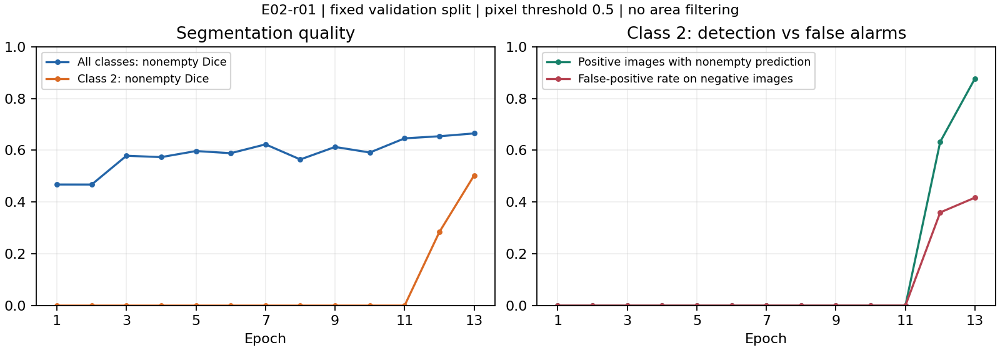

# 实验记录

[项目入口](../README.md) · [当前方案](当前方案.md) · [决策记录](决策记录.md)

截至 2026-10-23 13:34 核查，E02-r01 已于 11:44 完成 30 轮，当前没有训练任务运行。按全部非空 Dice 选中第 29 轮；类别 2 空预测漏检 1/49，非空 Dice 0.5884，阴性图误报 738/2465。最终权重的面积复查及后续成员尚未执行；中途诊断见 E06-r01、E05-r01。

## 实验索引

| 编号 | 问题与比较 | 关联决策 | 状态与产物 |
| --- | --- | --- | --- |
| <a id="e01"></a>E01 | 完整公开集成能否加载并生成四类缺陷可视化；核对预处理、融合、TTA 与面积过滤顺序 | D03—D05、D36 | E01-r02 完成；转换比较、摘要及精选图已回传 Mac |
| <a id="e02"></a>E02 | Legion 上按同一划分训练候选分割器与分类器；记录逐成员效果、显存和时间 | D06—D07、D10—D18、D23—D26、D33—D35 | E02-r01 完成 30 轮，选中第 29 轮；其他成员未训练 |
| <a id="e03"></a>E03 | 单体与成员组合相比，新增多少正确检出、误报与耗时 | D09、D19、D21 | 待做；使用 E02 预测，输出组合比较与案例 |
| <a id="e04"></a>E04 | 无门控、硬门控、概率相乘、动态面积阈值分别改变了哪些判断 | D08、D13、D21 | 待做；输出逐类及小缺陷检出、误报漏报和阈值附近表现 |
| <a id="e05"></a>E05 | 整类总面积与连通区域过滤分别删除了噪声还是小缺陷 | D20—D21、D37—D38 | E05-r01 已完成整类总面积诊断；连通区域比较待做 |
| <a id="e06"></a>E06 | 类别 2 漏检来自训练暴露不足、阈值还是定位能力；随训练进展复查 | D37—D38 | E06-r01 已完成：裁剪暴露与第 11 轮概率诊断 |

E03—E05 使用同一验证划分做开发比较；该划分用于选模和方法诊断，独立测试成绩另行报告。若先用公开权重做案例探索，在该次记录中标明数据用途。改变实验问题新增编号，同一问题的运行使用 `E02-r01` 等子编号。

## 每次运行记录

### E02-prep · 2026-10-23 · 完成：数据与运行准备

- 代码版本：`271bef6`；Mac、Legion 裸仓库及训练副本已同步。
- 数据：公开镜像第 1 版，压缩包 1,684,204,253 bytes；12,568 张训练图、5,506 张测试图、7,095 条非空 RLE 标注。
- 分层划分：seed 42，训练 10,054 张、验证 2,514 张；类别阳性总数 897/247/5150/801，训练 718/198/4120/641，验证 179/49/1030/160。
- 检查：5 项测试通过，覆盖 RLE 列顺序、空掩膜 Dice、两种 CSV 格式、原图划分和裁剪后的分类标签。
- 环境：RTX 3070 Laptop 8GB；Python 3.12.14、PyTorch 2.7.1+cu128、SMP 0.5.0；完整环境记录在 Legion `runs/setup/environment.txt`。
- 产物：Legion 工作副本的 `data/split_seed42.json`、`data/data_source.json`、`weights/weights_source.json`。

### E01-r01 · 2026-10-23 · 失败：公开模型格式加载

- 实现：`271bef6`，`severstal.public_demo`，原作者三个 U-Net 权重，计划测试集前 32 张展示。
- 结果：PyTorch 2.7.1 在 `torch.jit.load` 报 `Legacy model format is not supported on mobile`，尚未进入推理，没有预测或指标。
- 定位：原文件包含 `traced/attributes.pkl`、`traced/tensors/`，属于早期 TorchScript 存档格式；并非 GPU 容量不足。
- 下一步：独立旧版 CPU 环境读取后重新保存，比较转换前后的模型输出，再交给现有 GPU 环境推理；不更换模型和融合逻辑，关联 D36。
- 产物：Legion `runs/setup/E01-r01.log`；原模型保留在 `weights/lightforever/`。

### E02-smoke01 · 2026-10-23 09:40 · 完成：短训练检查

- 实现：`271bef6`，`configs/unet_resnet34.yaml`，ImageNet ResNet34 编码器；覆写为 1 epoch、8 个训练 batch、验证集前 16 张，其余沿用配置。
- 设置：256×512 裁剪、batch 4、AMP；完整图验证。检查数据读取、损失、反向传播、验证和权重保存能否连通。
- 资源：8 个训练 batch 1.76 秒，16 图验证 0.53 秒；峰值分配显存 794.8 MiB，不含模型初始化下载耗时。
- 结果：完整结束；非空 Dice 0.1464、整体 Dice 0.0252。这只是运行检查，样本和训练步数不足，不作为模型性能结论。
- 产物：Legion `runs/E02-smoke01/` 的配置、划分、日志、最佳与最近权重；控制台日志为 `runs/setup/E02-smoke01.log`。
- 结论：当前 batch 4 能运行，下一次使用完整训练和验证划分。D34 的容量起点已验证，实际单轮预算待测。

### E01-r02 · 2026-10-23 · 完成：公开三模型完整展示

- 实现：`d0c1e67`，原作者三个 U-Net，不替换架构和参数。保留原 logits 平均、sigmoid、水平翻转还原后平均、0.5 阈值与 600/600/1000/2000 面积过滤；实际 batch 1、float32。
- 格式迁移：Python 3.7.12 / PyTorch 1.4.0+cpu 读取原权重并重新保存，PyTorch 2.7.1 读取新存档。使用测试图 `0000f269f.jpg` 的完整 256×1600 输入，在两环境各做 CPU 前向。
- 比较：三个模型均通过 `atol=1e-4, rtol=1e-4`；最大 logits 绝对差为 2.63e-4 / 1.43e-4 / 1.58e-4，单模型 0.5 阈值掩膜一致率均为 100%。这是单图兼容验证；记录见[转换结果](results/E01-r02/conversion-verification.json)。
- GPU 展示：按文件名排序的前 32 张测试图，14.50 秒，峰值分配显存 427.5 MiB。时间包含后处理与文件保存，不含模型加载；四类预测阳性图分别 3/1/19/3。
- 结果：三模型、TTA、后处理、RLE 和可视化流程完整跑通。测试图无标签，本次没有精度成绩，不据此宣称复现榜单分数。
- 产物：Legion `runs/E01-r02/` 保存全部概率、RLE 和叠加图；原权重及转换参考保留在 `weights/`。Mac 已保存[摘要](results/E01-r02/summary.json)与三个示例，颜色为类别 1 红、2 绿、3 蓝、4 黄：
  - [类别 1 与 3 的预测](results/E01-r02/00df5b714.png)
  - [类别 2 的预测](results/E01-r02/0126f74ef.png)
  - [类别 3 与 4 的预测](results/E01-r02/017796c88.png)
- 结论：D03—D04、D36 的展示迁移路线已跑通；后续独立比较仍使用自主训练的统一划分。

### E02-r01 · 2026-10-23 09:50—11:44 · 完成：首个完整自主训练

- 问题：在统一图像划分下建立首个可比较的分割成员，记录实际性能、错误与训练成本；关联 D10、D33—D35。
- 实现：`d0c1e67`，启动时工作副本干净，`configs/unet_resnet34.yaml`；U-Net + ResNet34，ImageNet 编码器，完整设置见运行目录 `config.yaml`。
- 数据：10,054 张训练、2,514 张验证，共享 `data/split_seed42.json`，本次不截短训练或验证样本。
- 预算：最多 30 轮，连续 7 轮非空 Dice 未改善则停止；逐轮保存日志和检查点，当前不启动其他成员。
- 进程与产物：Legion 原 PID `46972`（已结束），控制台 `runs/setup/E02-r01.log`，运行目录 `runs/E02-r01/`。训练期间工作副本保持 `d0c1e67`；Mac 与裸仓库可继续提交文档。
- 首轮实测：完整训练 119.03 秒，验证 31.17 秒，峰值分配显存 794.8 MiB；整体 Dice **0.5351**、非空 Dice **0.4678**。约 2.5 分钟/轮，若维持此速度且跑满 30 轮约 75 分钟，不含额外分析。
- 原始材料：[首轮指标](results/E02-r01/epoch01.json)、[启动记录与实际配置](results/E02-r01/start.jsonl)。后续逐轮结果持续保存在 Legion `history.jsonl`，下表是第 1 轮快照，不代表最终权重。

| 类别 | 整体 Dice | 非空 Dice | 图像—类别检出率 | 误报对数 | 漏检对数 |
| --- | --- | --- | --- | --- | --- |
| 1 | 0.2345 | 0.4000 | 92.18% | 1817 | 14 |
| 2 | 0.9805 | 0.0000 | 0.00% | 0 | 49 |
| 3 | 0.3010 | 0.5745 | 99.51% | 1319 | 5 |
| 4 | 0.6245 | 0.0002 | 36.88% | 784 | 101 |

**第 1 轮时的观察及当时下一步：**类别 2 的整体 Dice 达到 0.9805，但 49 个阳性样本全部漏检，实际体现了 D07 所担心的空样本掩盖问题；类别 1/3 仍有大量误报，类别 4 的粗略检出不等于轮廓正确。当前只有一轮，先保持配置继续训练。若后期仍存在这些问题，再按真实小缺陷、采样和门控方向补查资料并设计对照；不把首轮现象直接归因于某个架构。

### E02-r01 · 2026-10-23 10:35—10:42 复查

训练继续运行，没有改动正在运行的代码、配置或划分。记录来自[前 13 轮快照](results/E05-r01/history_snapshot.jsonl)和[10:42 状态](results/E06-r01/latest_training_review.json)。第 13 轮为面积诊断时的最佳权重；最新最佳已更新为第 14 轮。学习率在第 10 轮结束时降到 1.5e-4；类别 2 随后开始出现预测，但当前无法分离降学习率与继续训练各自的贡献。

| 轮次 | 全部非空 Dice | 类别 2 非空 Dice | 阳性图预测非空 | 空预测漏检 | 阴性图误报 / 2465 |
| --- | --- | --- | --- | --- | --- |
| 1 | 0.4678 | 0 | 0/49 | 49 | 0 |
| 7 | 0.6229 | 0 | 0/49 | 49 | 0 |
| 11 | 0.6462 | 0 | 0/49 | 49 | 0 |
| 12 | 0.6542 | 0.2841 | 31/49 | 18 | 887 |
| 13 | 0.6652 | 0.5031 | 43/49 | 6 | 1028 |
| 14（当时最佳权重） | 0.6695 | 0.4566 | 44/49 | 5 | 814 |
| 15（10:42 最新完成） | 0.6571 | 0.4696 | 41/49 | 8 | 804 |

**解释：**类别 2 的漏检明显改善，并非一直学不会；但第 13 轮 43 个非空预测中，只有 40 个与真实掩膜存在交集，另 3 个画在了错误位置。因此“检出率 87.76%”仅表示阳性图上有输出；有交集的比例为 81.63%，轮廓质量仍以非空 Dice 表示。阴性图误报率为 41.70%。

第 15 轮仍比早期改善明显，但相对第 13—14 轮有波动；阴性图误报降至 804/2465（32.62%），依然偏多。当前最佳权重的选择依据是全部非空 Dice，因此第 14 轮整体最佳不等于类别 2 的非空 Dice 最佳。保持原选模规则，同时记录逐类结果，避免混淆两个结论。

最近三轮训练加验证为 233—248 秒/轮，已慢于首轮估算；按此速度跑满 30 轮，10:42 时预计还需约一小时，早停则提前结束。



**思路如何变化：**最初看到前 7 轮全漏检，先检查裁剪暴露和第 11 轮概率；诊断期间第 12—13 轮开始检出缺陷，问题转为漏检与大量误报并存。因此保留裁剪不足的证据，先让本轮继续，再优先检查无需重训的面积过滤。这个决定对应 D37，不把较早 checkpoint 的诊断当作最新模型的结论。

### E06-r01 · 2026-10-23 · 完成：裁剪暴露与第 11 轮概率诊断

- 触发：前 7 轮类别 2 全部漏检；检查它实际接触了多少正例，以及降低阈值能否恢复定位。
- 实现：[诊断脚本](../severstal/analyze_class2.py)。为保持训练副本固定，将脚本副本放在 Legion `runs/setup/analyze_class2_review01.py` 执行，依赖的训练模块为 `d0c1e67`。GPU 继续训练，诊断使用单线程 CPU。
- 权重：复制当时 `best.pt` 为独立文件，实际是第 11 轮；ImageNet 初始化来源沿用 E02-r01。推理为 CPU float32、全图、无 TTA；本次不改变正式阈值。
- 裁剪统计：遍历每张阳性训练图全部 1089 个合法横向起点，精确计算 512 宽窗口仍含该类缺陷的概率；下表是**每轮期望暴露量**，不是声称已记录了每个历史随机裁剪。

| 类别 | 阳性训练原图 | 阳性图裁剪后仍有缺陷 | 每轮预期阳性裁剪 | 占全部裁剪 |
| --- | --- | --- | --- | --- |
| 1 | 718 | 47.73% | 342.7 | 3.41% |
| 2 | 198 | 33.92% | 67.2 | 0.67% |
| 3 | 4120 | 62.50% | 2575.0 | 25.61% |
| 4 | 641 | 61.16% | 392.0 | 3.90% |

类别 2 原图掩膜面积中位数 3055.5 像素；经裁剪后，其正像素约占该通道训练像素的 0.01698%。这支持“正例暴露稀少可能拖慢学习”的假设，不能单凭计数证明它是唯一原因。

- 概率子集：验证集全部 49 张类别 2 阳性图，加 seed 42 随机抽取的 196/2465 张阴性图。阴性误报只适用于该诊断子集，不代替全量验证指标。

| 像素阈值 | 阳性图预测非空 | 与标注有交集 | 非空 Dice | 子集阴性误报 / 196 |
| --- | --- | --- | --- | --- |
| 0.1 | 36/49 | 23/49 | 0.2215 | 136 |
| 0.2 | 31/49 | 17/49 | 0.1959 | 109 |
| 0.3 | 25/49 | 16/49 | 0.0998 | 72 |
| 0.4 / 0.5 | 0/49 | 0/49 | 0 | 0 |

- 结论：第 11 轮有部分低置信定位信号；直接降低阈值同时放出很多错误区域，不能据此认定漏检已解决。后续第 13 轮在原 0.5 阈值下已有改善，下一步依据较新的权重判断。
- 耗时与产物：357 秒，未用 GPU。Legion `runs/E06-r01/` 保存固定权重、脚本关联日志和结果；Mac 保存[摘要](results/E06-r01/summary.json)、[裁剪统计](results/E06-r01/crop_exposure.json)、[逐图概率诊断](results/E06-r01/probability_rows.json)。

### E05-r01 · 2026-10-23 10:35 · 完成：第 13 轮整类面积过滤

- 触发：类别 2 在第 13 轮出现 1028 张阴性图误报。S01、S09 支持研究整类面积过滤，而对连通区域过滤的经验有分歧；先比较整类面积，保留原像素阈值 0.5。
- 实现：[面积复查脚本](../severstal/review_area.py)，直接使用第 13 轮完整 2514 张验证图的预测面积、标注面积和 Dice；整类清零后的分数可精确重算，无需再次前向。没有改变模型参数。

| 最小面积（像素） | 阴性误报 | 空预测漏检 | 与标注有交集 / 49 | 非空 Dice | 类别整体 Dice |
| --- | --- | --- | --- | --- | --- |
| 0 | 1028 | 6 | 40 | 0.5031 | 0.5814 |
| 200 | 856 | 9 | 40 | 0.5031 | 0.6498 |
| 600 | 671 | 10 | 39 | 0.4983 | 0.7233 |
| 1000 | 542 | 11 | 38 | 0.4981 | 0.7746 |
| 2000 | 327 | 24 | 25 | 0.3344 | 0.8570 |

**观察：**200 像素过滤删除 172 个阴性误报（16.73%），保留全部 40 个有交集的阳性图，非空 Dice 不变；它另外删掉了 3 个原本位置错误的“阳性图非空预测”。600 像素进一步降误报，却损失一个有交集的样本。2000 像素让整体 Dice 继续升高，但明显损伤定位和检出，不能只按整体分数选择。

**决定：**先保留 200 和原公开方案使用的 600 为后续比较点，待本轮训练完成后在最终选定权重上复查，暂不修改正式推理默认值；若仍有大量误报，再进入分类门控实验。此处为同一验证集上的探索结果，尚无独立测试成绩。关联 D37—D38。

- 产物：[全部类别的面积曲线数据](results/E05-r01/summary.json)、[第 13 轮原指标](results/E05-r01/best_metrics.json)、[逐图原始记录](results/E05-r01/best_validation.jsonl)。Legion 目录为 `runs/E05-r01/`；运行脚本副本在 `runs/setup/review_area_r01.py`。

### E02-r01 · 2026-10-23 13:34 核查 · 训练完成

- 完成状态：30/30 轮，日志以 `complete` 结束，原进程已退出；日志最后更新时间 11:44。累计训练与验证 6809 秒（113.5 分钟）。训练源码保持 `d0c1e67`，无中途改参。
- 权重：`runs/E02-r01/best.pt` 为第 29 轮，按全部非空 Dice 0.6951 选中；`last.pt` 保留第 30 轮完整续训状态。第 29 轮整体 Dice 为 0.5898；第 30 轮整体 Dice 更高（0.6853），但非空 Dice 为 0.6758，未替换按既定规则选择的最佳权重。

| 第 29 轮类别 | 非空 Dice | 阳性图预测非空 | 空预测漏检 | 阴性图误报 |
| --- | --- | --- | --- | --- |
| 1 | 0.6179 | 177/179 | 2 | 1231 |
| 2 | 0.5884 | 48/49 | 1 | 738 |
| 3 | 0.7107 | 1029/1030 | 1 | 817 |
| 4 | 0.7141 | 160/160 | 0 | 907 |

类别 2 的 48 个非空预测中，47 个与真实掩膜有交集；相比早期全部漏检已有明显改善，但误报率仍为 29.94%，后处理与分类门控仍值得比较。这些指标均来自固定验证划分、像素阈值 0.5、无面积过滤，并非公开榜或独立测试成绩。

- 已做：数据与划分、一个完整自主训练成员、逐轮评价与权重保存；E01 的公开三模型展示；E05/E06 的中途诊断。
- 尚未做：第 29 轮权重的面积复查；FPN + SE-ResNeXt50、U-Net + EfficientNet-B3 和分类器训练；自主模型融合与门控对照；完整交互 demo、报告、slides 和最终提交包。
- 下一步仍按 D37：先复查第 29 轮的面积过滤，再根据剩余误报安排分类门控；当前没有自动启动后续训练。
- 原始材料：[完成核查](results/E02-r01/completion_review.json)、[30 轮历史](results/E02-r01/history.jsonl)、[最佳权重指标](results/E02-r01/best_metrics.json)。大权重保留在 Legion，未回传 Git。

复制下面的短格式填写；未发生的结果留空，不为记录单独制造产物。

```text
E编号-r编号｜日期｜完成 / 失败 / 中止
问题与关联决策：
触发依据：具体错误、指标变化或 S 编号；本次要检验的假设。
数据与划分：原图清单或划分文件、训练/验证数量。
实现：代码版本或入口文件、配置路径、初始化权重来源。
设置：模型、尺寸、损失、优化器、学习率、batch、轮数、增强、采样；相对上次改变项。
资源：设备、耗时、峰值显存。
结果：整体/非空/逐类指标、主要误报漏报；失败则记录原因。
产物：权重、预测、指标、图像的实际路径。
结论：观察到什么，保留或放弃什么，更新哪个 D。
```

评测附上所用门控、阈值与后处理配置；已有配置文件时直接引用，不重复抄写全部参数。报告与 slides 从这些记录取结果和案例。
